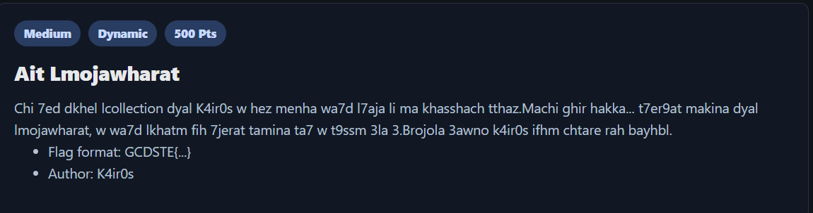
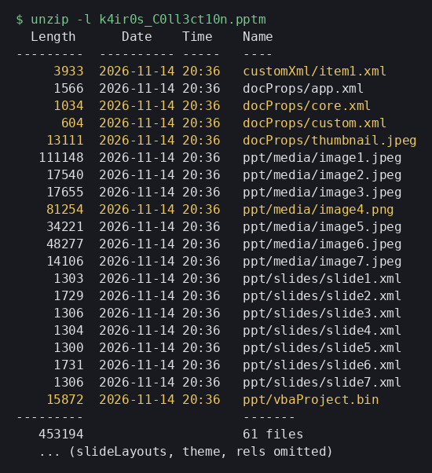
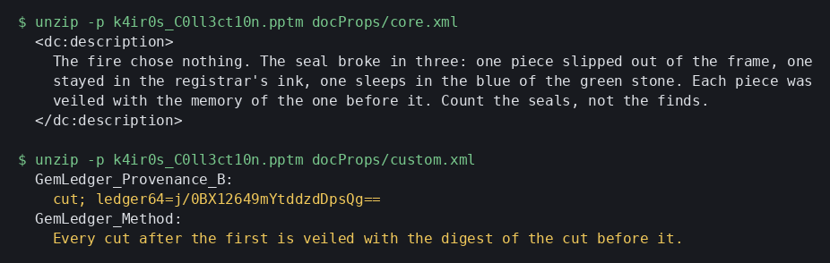
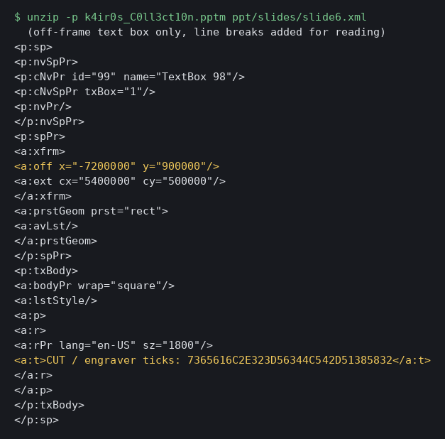
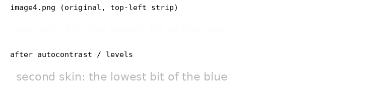
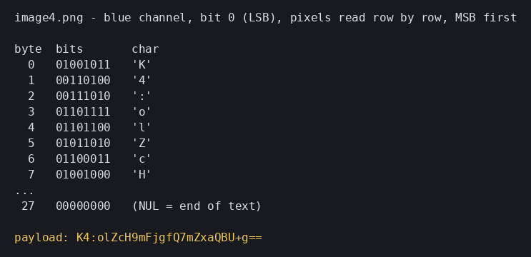
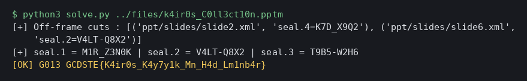

# Ait Lmojawharat

| | |
|---|---|
| **Category** | Forensics |
| **Difficulty** | Medium |
| **Type** | Dynamic |
| **Points** | 500 |
| **Author** | K4ir0s |
| **Flag** | `GCDSTE{K4ir0s_K4y7y1k_Mn_H4d_Lm1nb4r}` |

## Description



> Chi 7ed dkhel lcollection dyal K4ir0s w hez menha wa7d l7aja li ma khasshach tthaz. Machi ghir hakka... t7er9at makina dyal lmojawharat, w wa7d lkhatm fih 7jerat tamina ta7 w t9ssm 3la 3. Brojola 3awno k4ir0s ifhm chtare rah bayhbl.

*(Translation: Someone entered K4ir0s's collection and took something that should not be taken. Not only that... the gem machine burned, and a ring with precious stones fell and broke into 3 pieces. Please help K4ir0s understand what happened, he is clearly going crazy.)*

**Flag format:** `GCDSTE{...}`

## Files

- [`files/k4ir0s_C0ll3ct10n.pptm`](files/k4ir0s_C0ll3ct10n.pptm): a PowerPoint file with macros (7 slides)

## TL;DR

1. A `.pptm` is a **ZIP archive** of XML files. The description inside `core.xml` is a riddle: the seal broke in 3 pieces, each piece is veiled with the previous one, and "count the seals, not the finds".
2. **seal.2** is in a text box placed **outside the slide** (hex encoded). A second box on another slide is a **decoy** (`seal.4`).
3. **seal.1** is in a custom property (`ledger64`), XORed with `SHA-256(seal.2)`.
4. **seal.3** is hidden in the **blue LSBs** of `image4.png`, XORed with `SHA-256(seal.1)`. A pale text on the picture gives the hint.
5. Password = `seal.1|seal.2|seal.3` (ordered by seal **number**, not by discovery order). With the salt `SHA-256(thumbnail.jpeg)[:16]`, derive a key with scrypt and try it on the 24 AES-GCM vaults of `customXml/item1.xml`.
6. **5 vaults open**, but only one gives the real flag. The others are decoys.

---

## Solution

### Step 1: Open the file as a ZIP

```
$ file k4ir0s_C0ll3ct10n.pptm
k4ir0s_C0ll3ct10n.pptm: Microsoft OOXML
$ unzip k4ir0s_C0ll3ct10n.pptm -d x
```

The interesting files:

| Path | What it holds |
|---|---|
| `docProps/core.xml` | title, and a **description** (the riddle) |
| `docProps/custom.xml` | custom properties: `ledger64` and `GemLedger_Method` |
| `docProps/thumbnail.jpeg` | used later as the **salt** |
| `ppt/slides/slideN.xml` | the 7 slides |
| `ppt/media/image4.png` | the only PNG (the others are JPEG) |
| `customXml/item1.xml` | an `<inventory>` with **24 gems** (`G001` to `G024`), each with a base64 `cert` |
| `ppt/vbaProject.bin` | macros |



The riddle in `core.xml`:

> The fire chose nothing. The seal broke in three: one piece slipped out of the frame, one stayed in the registrar's ink, one sleeps in the blue of the green stone. Each piece was veiled with the memory of the one before it. Count the seals, not the finds.

It gives the plan without giving the method:

| Words | Meaning |
|---|---|
| "slipped out of the frame" | a piece outside the slide (off-frame text box) |
| "the registrar's ink" | a piece in the document properties (the *ledger*) |
| "the blue of the green stone" | a piece in the blue channel of the picture |
| "veiled with the memory of the one before" | each piece is XORed with a hash of the previous one |
| "count the seals, not the finds" | the order is the **seal number**, not the order you find them |

`custom.xml` adds two properties (the riddle and the properties are shown below):



```
GemLedger_Provenance_B : cut; ledger64=j/0BX12649mYtddzdDpsQg==
GemLedger_Method       : Every cut after the first is veiled with the digest of the cut before it.
```

The **macros** (`vbaProject.bin`) are a leftover: `strings` only shows default workbook modules (`ThisWorkbook`, `Sheet1`) and a "Hello" string. Nothing has to be executed.

### Step 2: seal.2, the text box outside the slide

In the XML of the slides, two text boxes have `<a:off x="-7200000" ...>`: a negative `x`, so they are far to the left of the slide and invisible in PowerPoint. They are in `slide2.xml` and `slide6.xml`, and their text is hexadecimal:

```
slide6 : CUT / engraver ticks: 7365616C2E323D56344C542D51385832
slide2 : CUT / engraver ticks: 7365616C2E343D4B37445F58395132
```



Decode the hex (CyberChef, *From Hex*):

```
7365616C2E323D56344C542D51385832 -> seal.2=V4LT-Q8X2
7365616C2E343D4B37445F58395132   -> seal.4=K7D_X9Q2
```

The seal broke in **3** pieces, so `seal.4` cannot be real: it is a **decoy**. The real piece is **`seal.2 = V4LT-Q8X2`**. Only the value (`V4LT-Q8X2`) will be used, without the `seal.2=` prefix.

### Step 3: seal.1, the veiled property

`ledger64` is base64, but decoding it gives noise. The method says each cut is veiled with the digest of the cut **before** it. The first cut is the one in clear text (`seal.2`), so:

```python
import base64, hashlib
key  = hashlib.sha256(b"V4LT-Q8X2").digest()
data = base64.b64decode("j/0BX12649mYtddzdDpsQg==")
print(bytes(a ^ b for a, b in zip(data, key)))   # b'seal.1=M1R_Z3N0K'
```

In CyberChef: *From Base64*, then *XOR* with the key `SHA-256("V4LT-Q8X2")` (hex). The result is **`seal.1 = M1R_Z3N0K`**.

### Step 4: seal.3, the picture

`ppt/media/image4.png` is a picture of a gem. At the top left there is a text so pale that it cannot be seen (the values are around 252 on 255). A strong **autocontrast** reveals it:



> second skin: the lowest bit of the blue

So the next data is in the **least significant bit of the blue channel**. Classic tools should find it directly:

- `zsteg image4.png` gives the pattern `b1,b,msb,xy` (blue channel, bit 1 plane, MSB first, row by row)
- StegSolve: *Blue plane 0*

With Python (bits are read pixel by pixel, row by row, from the first pixel, most significant bit first):

```python
import numpy as np
from PIL import Image
a = np.array(Image.open("image4.png").convert("RGB"))
bits = a[:, :, 2].reshape(-1) & 1
raw = np.packbits(bits).tobytes().split(b"\x00")[0]
print(raw)    # b'K4:olZcH9mFjgfQ7mZxaQBU+g=='
```



The text starts with the marker `K4:`, then a base64 value. Same veil as before, with `seal.1` as the key now:

```
base64 decode, then XOR with sha256("M1R_Z3N0K")  ->  seal.3=T9B5-W2H6
```

**`seal.3 = T9B5-W2H6`**. The message is in the first row of pixels, and the pale text is lower on the picture so that it does not disturb it.

> **Why a PNG?** A JPEG compression destroys the LSBs. The other images of the file are JPEG, and `image4.png` is the only PNG: this is a hint by itself. Never recompress the picture.

### Step 5: Build the password

The order is the **seal number**, not the order of discovery:

| Seal | Value | Found in order |
|---|---|---|
| seal.1 | `M1R_Z3N0K` | 2nd |
| seal.2 | `V4LT-Q8X2` | 1st |
| seal.3 | `T9B5-W2H6` | 3rd |

```
password = M1R_Z3N0K|V4LT-Q8X2|T9B5-W2H6
```

(parts separated by `|`, in the order 1, 2, 3).

### Step 6: Salt, key and vaults

The challenge statement gives the crypto setup: **scrypt** to derive the key and **AES-256-GCM** for the vaults (parameters below). The salt is not written anywhere: it comes from the file itself.

| Parameter | Value |
|---|---|
| Salt | first 16 bytes of `SHA-256(docProps/thumbnail.jpeg)` = `0894b20ce3cf6b2444b46bacff00755d` |
| scrypt | `N = 2^18`, `r = 8`, `p = 1`, key length 32 bytes |
| Key | `d8cc74247fa87343086c19756b799ed40cf4332bfb8d33aa445d6a7ffef026d2` |
| Vault format | `base64( nonce (12 bytes) + ciphertext + GCM tag )` |
| AAD | `K4-INV07` |

```python
salt = hashlib.sha256(open("thumbnail.jpeg", "rb").read()).digest()[:16]
key  = hashlib.scrypt(password.encode(), salt=salt, n=2**18, r=8, p=1,
                      dklen=32, maxmem=1024*1024*1024)
AESGCM(key).decrypt(blob[:12], blob[12:], b"K4-INV07")
```

Try this key on the 24 `cert` values of `customXml/item1.xml`. **Five** vaults open, and not all of them give a good flag:

| Vault | Password order | Content | Role |
|---|---|---|---|
| **G013** | `1\|2\|3` | `GCDSTE{K4ir0s_K4y7y1k_Mn_H4d_Lm1nb4r}` | **real flag** |
| G006 | `2\|1\|3` (discovery order) | `GCDSTE{K4ir0s_F4k3_S34l_Wr0ng_0rd3r}` | trap: wrong order |
| G005 | `1\|2\|4` | `GCDSTE{K4ir0s_F4k3_S34l_Th3_F0urth_Cut}` | trap: decoy `seal.4` instead of `seal.3` |
| G007 | `1\|4\|3` | `GCDSTE{K4ir0s_F4k3_S34l_D3c0y_Cut_D}` | trap: decoy in second place |
| G003 | `1\|2\|3\|4` | `GCDSTE{K4ir0s_F4k3_S34l_Tr1ed_T00_H4rd}` | trap: 4 parts |

The 19 other vaults hold random bytes and never open.

> **Important:** a vault that opens is **not** a proof that the path is right. The decoy flags have the right format `GCDSTE{...}`, but a careful player notices `F4k3_S34l` ("fake seal") in the text. Check the seal numbers and the order.

The flag:

```
GCDSTE{K4ir0s_K4y7y1k_Mn_H4d_Lm1nb4r}
```

## Solver

[`solve/solve.py`](solve/solve.py) follows the intended path: it finds the off-frame cuts, picks the real one (seal number 3 or lower), unveils `seal.1` and `seal.3`, derives the key and tries the 24 vaults. It needs `cryptography`, `Pillow` and `numpy`.

```
$ cd solve
$ pip install cryptography Pillow numpy
$ python3 solve.py ../files/k4ir0s_C0ll3ct10n.pptm
[+] Off-frame cuts : [('ppt/slides/slide2.xml', 'seal.4=K7D_X9Q2'), ('ppt/slides/slide6.xml', 'seal.2=V4LT-Q8X2')]
[+] seal.1 = M1R_Z3N0K | seal.2 = V4LT-Q8X2 | seal.3 = T9B5-W2H6
[OK] G013 GCDSTE{K4ir0s_K4y7y1k_Mn_H4d_Lm1nb4r}
```



Because the solver follows the right order (`1|2|3`), only the real vault opens here. To see the traps, try the other orders by hand (48 orderings of 3 or 4 seals: 5 vaults open in total).

## Flag

```
GCDSTE{K4ir0s_K4y7y1k_Mn_H4d_Lm1nb4r}
```

## Main Ideas For This Chall

- **Office files are ZIP archives** (`.pptm`, `.docx`, `.xlsx`): metadata, custom properties, media and custom XML can all hide data.
- **Hidden does not mean encrypted:** a text box with a negative position is invisible in PowerPoint but plain in the XML.
- **Chained secrets:** each piece is a key for the next one (XOR with a SHA-256 digest).
- **LSB steganography** in a PNG (blue plane, MSB first), and why JPEG compression destroys it.
- **A very pale text** can be revealed by an autocontrast.
- **Key derivation:** a password plus a salt taken from the file, with scrypt, then AES-GCM (the tag tells if the key is right).
- **Decoys:** a decryption that succeeds is not a proof. Read the riddle again ("count the seals") and check the result.

## Tools used

- `unzip`, `file`, `strings`
- CyberChef (*From Hex*, *From Base64*, *XOR*, *SHA2*)
- `zsteg` / StegSolve
- Python 3 (`cryptography`, `Pillow`, `numpy`)
