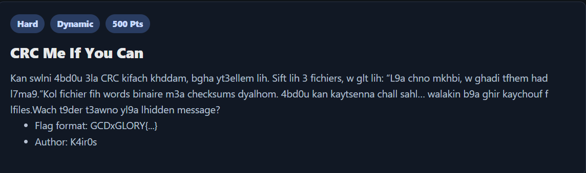

# CRC Me If You Can

| | |
|---|---|
| **Category** | Forensics |
| **Difficulty** | Hard |
| **Type** | Dynamic |
| **Points** | 500 |
| **Author** | K4ir0s |
| **Flag** | `GCDxGLORY{w43r_r4k_t3lmt1_lCRC_4BR00}` |

## Description



> Kan swlni 4bd0u 3la CRC kifach khddam, bgha yt3ellem lih. Sift lih 3 fichiers, w glt lih: "L9a chno mkhbi, w ghadi tfhem had l7ma9." Kol fichier fih words binaire m3a checksums dyalhom. 4bd0u kan kaytsenna chall sahl... walakin b9a ghir kaychouf f lfiles. Wach t9der t3awno yl9a lhidden message?

*(Translation: 4bd0u asked me how CRC works, he wants to learn. I sent him 3 files and told him: "Find what is hidden, and you will understand this madness." Each file has binary words with their checksums. 4bd0u expected an easy challenge... but he just stares at the files. Can you help him find the hidden message?)*

**Flag format:** `GCDxGLORY{...}`

## Files

- [`files/relay1.txt`](files/relay1.txt)
- [`files/relay2.txt`](files/relay2.txt)
- [`files/relay3.txt`](files/relay3.txt)

Each file has 45 lines like this one:

```
00000110110000111000011010111011 --> 10100000
```

## TL;DR

1. Each file has 45 lines: **37 useful lines** (one per flag character) and **8 decoys**. Decoys start with bit `1`.
2. The first 8 bits of the 32-bit word are the **position of the line, written in Gray code**. Remove the decoys, un-Gray the top byte, and sort.
3. The 8-bit output is a **CRC-8 checksum** of the 32-bit word, with rules that hide one flag letter per line. The three files use three different rules.
4. The **state** of a line is the *written output of the previous position* (the first line uses a *seed*). The flag prefix `GCDxGLORY{` lets you test hypotheses.
5. Brute-force the 256 possible polynomials (relay1, relay2) or compute the letter directly (relay3), then **vote** between the 3 files. A few outputs have one flipped bit (noise), and the vote removes their effect.

---

## Solution

### Step 1: Read the lines

Every line is `32 bits --> 8 bits`:

| Part | Meaning |
|---|---|
| 32 bits (left) | data given to the CRC |
| 8 bits (right) | checksum written in the file (may contain noise) |

The output is **not** the ASCII code of the letter: position 0 of relay1 has output `00110001` (49 = `1`), but the hidden letter is `G`.

### Step 2: Remove the decoys and sort the lines

The lines are shuffled. Looking at the first bit of each word, 37 lines start with `0` and 8 with `1`. The 8 lines starting with `1` are decoys: remove them.

The first 8 bits of the word (the *top byte*) are the position of the line, in **Gray code**. A Gray code is built with `gray = n ^ (n >> 1)`:

| Position | Binary | Gray |
|---|---|---|
| 0 | 00000000 | 00000000 |
| 1 | 00000001 | 00000001 |
| 2 | 00000010 | 00000011 |
| 3 | 00000011 | 00000010 |
| 4 | 00000100 | 00000110 |

To go back from Gray to the position:

```python
def ungray(g):
    i = 0
    while g:
        i ^= g
        g >>= 1
    return i
```

Example: `00000110110000111000011010111011 --> 10100000` has top byte `00000110`, so `ungray(6) = 4`, i.e. position **4** (not 6).

After this filter, each file has exactly the positions 0 to 36, with no gap and no duplicate. The same positions in all 3 files confirm the idea. The top byte stays part of the data: the **32 bits** go into the CRC.

### Step 3: The CRC-8 functions

CRC-8 gives 8 bits from the 4 bytes of the word. The two variants used here (`r` is the 8-bit register):

```python
def crc_msb(word, poly, init):          # shifts left
    r = init
    for byte in word.to_bytes(4, "big"):
        r ^= byte
        for _ in range(8):
            r = ((r << 1) ^ poly) & 0xFF if r & 0x80 else (r << 1) & 0xFF
    return r

def crc_lsb(word, poly, init):          # shifts right
    r = init
    for byte in word.to_bytes(4, "big"):
        r ^= byte
        for _ in range(8):
            r = (r >> 1) ^ poly if r & 1 else r >> 1
    return r
```

The parameters are *init* (start value of `r` for each line), *poly* (mask XORed during the rounds), *xorout* (a final XOR) and the direction (MSB or LSB).

### Step 4: Find the rules

The players do not receive the parameters. They have to guess them with the **known prefix** `GCDxGLORY{` (10 letters) and a small set of hypotheses: MSB or LSB, `init = 0` or the previous output, the letter hidden in `poly` or in `xorout`, final XOR `0` or `255`.

The rules for this challenge:

| | relay1 | relay2 | relay3 |
|---|---|---|---|
| init | state | state | 0 |
| poly | letter XOR state | letter XOR state | state |
| xorout | 0 | 0xFF | letter |
| direction | MSB | LSB | MSB |

The **state** of a line is the *written output of the previous position* (in the same file). Position 0 has no previous line, so it uses a **seed**.

**Example, relay1 position 1.** Word = `00000001100100011011011101011000`, state = previous output = `00110001`, letter `C` = `01000011`:

```
poly = 01000011 XOR 00110001 = 01110010
crc_msb(word, poly=0x72, init=0x31) = 01111100   <- the output written in the file
```

**Example, relay3 position 0.** Word = `00000000 01001111 11011111 10001110`, seed = `0x5A`, poly = state = seed, init = 0:

```
crc_msb(word, 0x5A, 0) = 10010010
output                 = 11010101
letter = 10010010 XOR 11010101 = 01000111 = 'G'
```

For relay3, the XOR with the output gives the letter back: `output = R ^ letter`, so `letter = R ^ output`. The next state is `11010101` (the **written output**, not the CRC and not the letter).

### Step 4b: The three relays in detail

All three relays use the same line format and the same Gray-coded position, but each one hides the letter in a different place. Below, each relay is shown on **position 3**, where the hidden letter is `x` (`01111000`) in all three files. The state is the written output of position 2 of the same file.

#### Relay1: the letter is hidden in `poly`

| Parameter | Value |
|---|---|
| init | state |
| poly | **letter XOR state** |
| xorout | 0 (nothing) |
| direction | MSB first (shift left) |

*Construction (what the author did).* For each line the author picks `poly = letter ^ state`, computes `crc_msb(word, poly, init=state)`, and writes that value as the output.

*Resolution (what the player does).* The letter is not stored anywhere, but `poly` has only 256 values. For each of them:

1. compute `crc_msb(word, poly, init=state)`;
2. if it equals the written output, `poly` is compatible;
3. then `letter = poly ^ state`;
4. keep the printable ones (32 to 126).

*Example, relay1 position 3:*

```
word    = 00000010 11001101 01100001 00111110
state   = 01010000      (output of position 2)
output  = 10011000

poly    = 00101000      (one of the 256 values that works)
crc_msb(word, poly=0x28, init=0x50) = 10011000   -> equals the output
letter  = poly XOR state = 00101000 XOR 01010000 = 01111000 = 'x'
```

Another poly gives the same output and a second candidate, `~`. That is why the result is a **set** of candidates (`x`, `~`) and not one letter, and why we need the other relays.

#### Relay2: LSB-first and final XOR

| Parameter | Value |
|---|---|
| init | state |
| poly | **letter XOR state** |
| xorout | **0xFF** (final XOR, once per line) |
| direction | **LSB first (shift right)** |

The letter is hidden in `poly` exactly like relay1. Two things change:

- **The direction.** The register is shifted to the **right**, and the bit tested before each shift is the **last bit** (LSB). The 4 bytes of the word are still processed in the same order (left to right); only the inside of the byte loop changes:

| Last bit of `r` | Operation in each round |
|---|---|
| 0 | `r = r >> 1` |
| 1 | `r = (r >> 1) XOR poly` |

- **The final XOR.** After the 4 bytes, the result is XORed **once** with `0xFF` (all bits flipped). It is done once at the end of the line, not in each round, and it is not used to recover the letter: the letter still comes from `poly ^ state`.

*Test of a candidate:* `crc_lsb(word, poly, init=state) XOR 0xFF == output`.

*Example, relay2 position 3:*

```
word    = 00000010 10011101 01100100 00111100
state   = 01011100      (written output of position 2)
output  = 11000100

poly    = 00100100
crc_lsb(word, poly=0x24, init=0x5C) = 00111011
00111011 XOR 11111111               = 11000100   -> equals the output
letter  = poly XOR state = 00100100 XOR 01011100 = 01111000 = 'x'
```

The first byte of the word (`00000010`) in the same example, round by round (`r = state XOR byte = 01011110` at the start):

| Round | r before | Last bit | Operation | r after |
|---|---|---|---|---|
| 1 | `01011110` | 0 | shift right only | `00101111` |
| 2 | `00101111` | 1 | shift right + XOR poly | `00110011` |
| 3 | `00110011` | 1 | shift right + XOR poly | `00111101` |
| 4 | `00111101` | 1 | shift right + XOR poly | `00111010` |
| 5 | `00111010` | 0 | shift right only | `00011101` |
| 6 | `00011101` | 1 | shift right + XOR poly | `00101010` |
| 7 | `00101010` | 0 | shift right only | `00010101` |
| 8 | `00010101` | 1 | shift right + XOR poly | `00101110` |

At the end of the 4 bytes, the register is `00111011`; the final XOR with `0xFF` gives the written output. relay2 returns three candidates for this position (`1`, `d`, `x`); `x` is the one also supported by relay1 and relay3.

#### Relay3: the letter is in the final XOR

| Parameter | Value |
|---|---|
| init | **0** (always) |
| poly | **state** |
| xorout | **letter** |
| direction | MSB first (shift left) |

Here the letter is not in `poly` any more: it is the final XOR value. `poly` is simply the state, and `init` stays zero for every line.

*Construction:* `output = crc_msb(word, poly=state, init=0) XOR letter`.

*Resolution:* if `R = crc_msb(word, state, 0)`, then `output = R ^ letter`, so

```
letter = R XOR output        (because R XOR R = 0 and 0 XOR letter = letter)
```

There is no brute force: one computation gives **one** candidate.

*Example, relay3 position 3:*

```
word    = 00000010 01101011 11000001 01010011
state   = 00111110      (output of position 2)
output  = 01000000

R = crc_msb(word, poly=0x3E, init=0) = 00111000
letter = 00111000 XOR 01000000 = 01111000 = 'x'
```

The state of the next line is `01000000` (the **written output**), not `R` and not the letter.

**Why `init = 0` here?** It is a construction rule of this relay, not a CRC rule. A different init would also work, but then all the outputs would be computed with it.

#### Summary

| | relay1 | relay2 | relay3 |
|---|---|---|---|
| Where is the letter? | in `poly` (`letter ^ state`) | in `poly` (`letter ^ state`) | in `xorout` |
| init | state | state | 0 |
| Direction | MSB (left) | LSB (right) | MSB (left) |
| Final XOR | 0 | `0xFF` | letter |
| Recover the letter | brute force 256 polys | brute force 256 polys | one XOR |
| Candidates per position | 0 to several | 0 to several | 0 or 1 |

### Step 5: The seeds

The seed is the state of position 0. It is only 8 bits, so we try all 256 values and keep the ones for which `G` is a candidate in position 0:

| File | Seed compatible with `G` |
|---|---|
| relay1 | `60` (0x3C) |
| relay2 | `55` (0x37) |
| relay3 | `90` (0x5A) |

> **Trap:** the construction seed of relay2 is `195` (0xC3), but position 0 of relay2 is noisy (see step 7), so the solver finds the false seed `55`. "Compatible with `G`" does **not** prove that a seed is the original one. This does not change the flag: the seed only affects position 0, because from position 1 the state is the *written* previous output.

### Step 6: Candidates and vote

For each position:

- **relay1 / relay2:** try the 256 values of `poly`, keep those for which the CRC matches the output, and take `letter = poly ^ state`. Several polys can give the same output, so we get a **set** of candidates. Keep only the printable ASCII ones (32 to 126).
- **relay3:** one candidate, `crc_msb(word, state, 0) ^ output`.

Then each file votes for its candidates, and the letter with the most votes wins. A few positions:

| Position | relay1 | relay2 | relay3 | Winner |
|---|---|---|---|---|
| 3 | `x`, `~` | `1`, `d`, `x` | `x` | `x` (3 votes) |
| 10 | `w` | `*`, `w` | `g` | `w` (2 votes) |
| 19 | `t` | `2`, `6`, `S`, `U`, `k`, `t` | `4` | `t` (2 votes) |

At position 10, relay3 gives `g`, but relay1 and relay2 both support `w`. We do not trust one file alone, even when it gives a single candidate.

### Step 7: The noise

Some outputs have **one bit flipped** (not a decoy line). The line stays at its position, but its output is wrong. Because the next state is the written output, a wrong output also breaks the **next** position (one more wrong state), and the state is correct again after that:

| File | Wrong outputs (position) | Clean output | Written | XOR |
|---|---|---|---|---|
| relay1 | 14 | `0x8D` | `0x9D` | `0x10` |
| relay1 | 29 | `0x0A` | `0x0B` | `0x01` |
| relay2 | 0 | `0x95` | `0xB5` | `0x20` |
| relay2 | 34 | `0x55` | `0xD5` | `0x80` |
| relay3 | 10 | `0x97` | `0x87` | `0x10` |
| relay3 | 19 | `0xF4` | `0xB4` | `0x40` |

Every XOR is a power of two, so exactly one bit changed. Because the noisy positions are different in each file (14/15/29/30 in relay1, 0/1/34/35 in relay2, 10/11/19/20 in relay3), at least two files stay correct at every position, and the vote removes the noise.

*(This table was recomputed with the final flag and the construction seeds, so it is organizer information. A player only sees that two files agree and one does not.)*

### Step 8: Run the solver

[`solve/solve.py`](solve/solve.py) uses only the standard library. It refuses ties and positions with fewer than 2 votes.

```
$ cd solve
$ python3 solve.py ../files
relay1.txt: 37 positions, 8 decoys
Relay 1 seeds compatible with 'G': [60]
relay2.txt: 37 positions, 8 decoys
Relay 2 seeds compatible with 'G': [55]
relay3.txt: 37 positions, 8 decoys
Relay 3 seeds compatible with 'G': [90]
Flag: GCDxGLORY{w43r_r4k_t3lmt1_lCRC_4BR00}
```

> The solver uses the *rules* of step 4. Finding those rules (the "discovery" part) is the real work of the challenge, and it is done with hypotheses, tests and cross-checks between the 3 files.

## Flag

```
GCDxGLORY{w43r_r4k_t3lmt1_lCRC_4BR00}
```

The flag has 37 characters (positions 0 to 36). The capital letters (`CRC`, `BR`) and the underscores must be kept as they are.

## Extra material

A long Darija / Latin-letters guide, with every calculation done by hand, the candidates for all 37 positions, an FAQ and exercises, is in [`writeup/CRConfusion_Guide_Detaille_Darija.pdf`](writeup/CRConfusion_Guide_Detaille_Darija.pdf).

## Main Ideas For This Chall

- A **CRC is a checksum, not encryption**: it detects errors, and its parameters (init, poly, xorout, direction) can be guessed with known plaintext.
- **Known-plaintext attacks:** the format `GCDxGLORY{` gives 10 known letters to test hypotheses.
- **Gray code** and how to reverse it (`gray = n ^ (n >> 1)`).
- **Chained state:** each line depends on the *written* output of the previous one.
- **Brute force of an 8-bit space** (256 polys or seeds), and why several values can give the same result.
- **Cross-checking evidence:** three independent files, a vote, and a refusal to choose when the support is weak.
- **A seed that fits one letter is not proof**: always check several positions and files.

## Tools used

- Python 3 (standard library)
- A text editor
