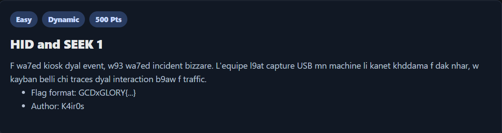
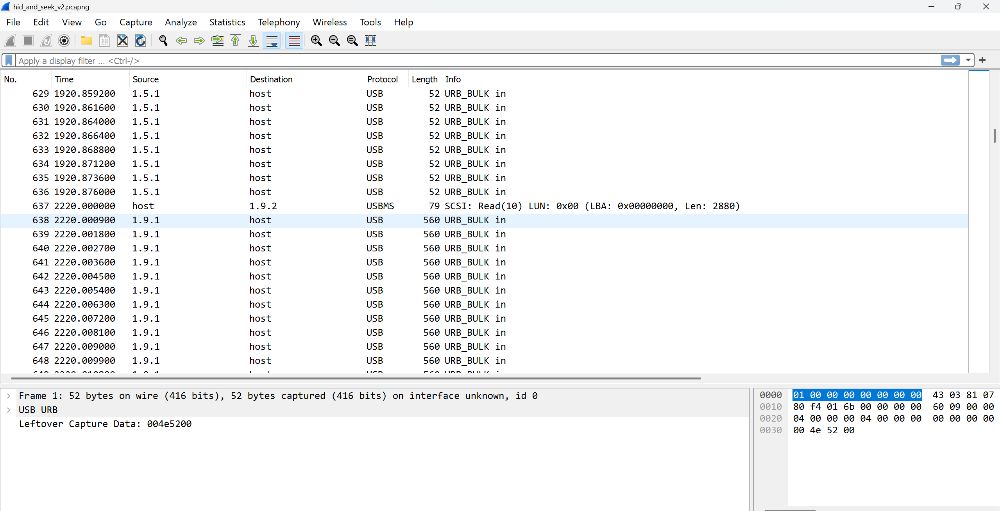
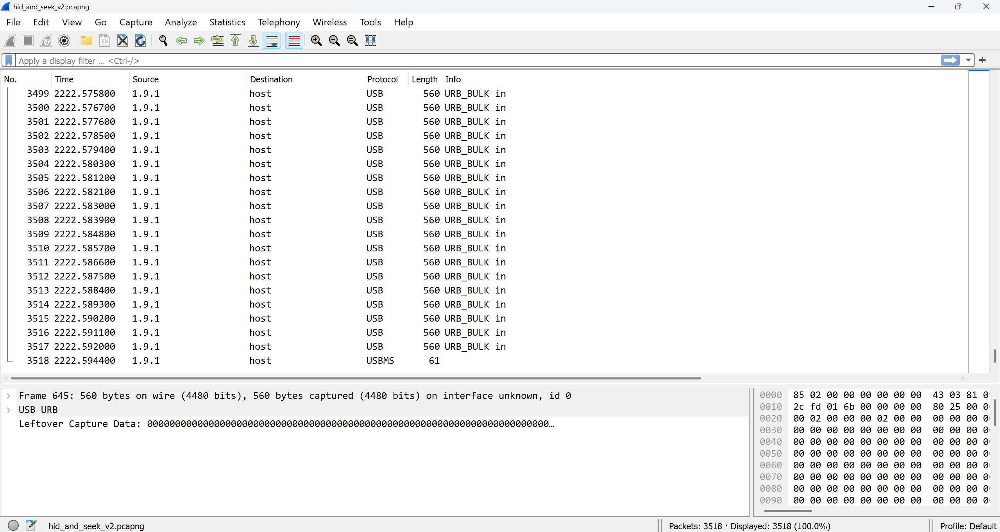
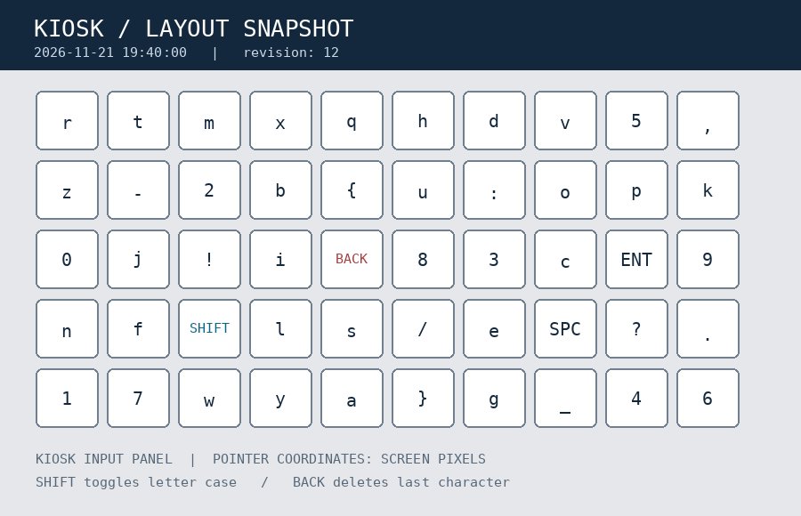
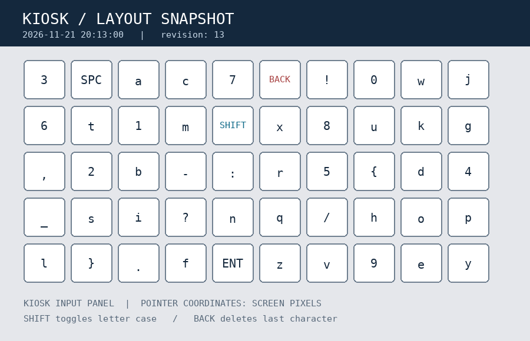

# HID and SEEK 1

| | |
|---|---|
| **Category** | Forensics |
| **Difficulty** | Easy |
| **Type** | Dynamic |
| **Points** | 500 |
| **Author** | K4ir0s |
| **Flag** | `GCDxGLORY{tkhb1t_t43y1t_ol9it1n1_br4v0}` |

## Description



> F wa7ed kiosk dyal event, w93 wa7ed incident bizzare. L'equipe l9at capture USB
> mn machine li kanet khddama f dak nhar, w kayban belli chi traces dyal
> interaction b9aw f traffic.

*(Translation: At an event kiosk, a strange incident happened. The team found a
USB capture from the machine that was running that day, and it looks like some
traces of user interaction remain in the traffic.)*

**Flag format:** `GCDxGLORY{...}`

## Files

- [`files/hid_and_seek_v2.pcapng`](files/hid_and_seek_v2.pcapng): a USB capture (3518 packets)

No hints were released during the event.

## TL;DR

1. The capture holds **three USB devices**: two mice (addresses `5` and `7`) and one **USB flash drive** (address `9`).
2. Rebuild the flash drive (a FAT12 floppy image) from the `READ(10)` data blocks.
3. In the FAT12 root directory, two **deleted** entries (`E5`) contain two PNG screenshots of an on-screen keyboard. The key order is **different** in each one (rev 12 and rev 13).
4. Replay the **mouse clicks** on the right keyboard. The timestamps in the screenshots tell us which mouse goes with which screenshot.
5. Mouse `5` + keyboard rev 13 gives the flag. Mouse `7` + rev 12 gives a decoy.

---

## Solution

### Step 1: First look at the capture

Open the file in Wireshark. Everything is `USB`, and nearly all packets are `URB_BULK in` with a `0x81` endpoint:



Two important details:
- There is **no network traffic** (no TCP, HTTP, DNS...), only USB.
- A plain `strings` on the file finds no flag. The flag is not stored in clear text anywhere, we have to rebuild it.

The last packets are also interesting, because they show a **USB Mass Storage** (`USBMS`) status packet:



So we need to know which devices are talking. Open **Statistics → Conversations → USB** (or filter on `usb.device_address`). Here is the summary of the streams:

| USB address | Endpoint | Packets | Packet size | What it is |
|---|---|---|---|---|
| 5 | `0x81` IN | 366 | 4 bytes | **Mouse** (HID report) |
| 7 | `0x81` IN | 270 | 4 bytes | **Mouse** (HID report) |
| 9 | `0x02` OUT | 1 | 31 bytes | Mass Storage **command** (CBW) |
| 9 | `0x81` IN | 2880 | 512 bytes | Mass Storage **data** (the disk) |
| 9 | `0x81` IN | 1 | 13 bytes | Mass Storage **status** (CSW) |

> **Trap:** `0x81` is *not* a device. It is just "endpoint 1, direction IN", and many devices have one.
> To separate the devices, you must also look at the **USB address**. Mixing both mice together gives a meaningless cursor path.

### Step 2: Rebuild the USB flash drive

Frame 637 is the key packet:

```
SCSI: Read(10)  LUN: 0x00  (LBA: 0x00000000, Len: 2880)
```

The host asks the drive to read **2880 sectors** from sector 0. A sector is 512 bytes, so:

```
2880 x 512 = 1 474 560 bytes = 1.44 MB  ->  a standard floppy size
```

The device answers with exactly **2880 packets of 512 bytes** (the `560 bytes` frames in Wireshark = 512 bytes of data + 48 bytes of USB header). If we concatenate them **in capture order**, we get the whole disk.

Do not include the 31-byte CBW (starts with `USBC`) or the 13-byte CSW (starts with `USBS`).

In Wireshark you can filter the data with:

```
usb.device_address == 9 && usb.endpoint_address == 0x81 && usb.data_len == 512
```

and export the payloads, or do it with a script (see [`solve/solve.py`](solve/parse.py)). Result: a 1 474 560 byte file `disk.img`.

```
$ file disk.img
disk.img: DOS/MBR boot sector, ... FAT (12 bit) ...
```

The boot sector (`MSDOS5.0`) gives us the **FAT12** geometry:

| Parameter | Value |
|---|---|
| Bytes per sector | 512 |
| Sectors per cluster | 1 |
| Reserved sectors | 1 |
| Number of FATs | 2 |
| Sectors per FAT | 9 |
| Root directory entries | 224 (14 sectors) |

From this we get the layout:

```
Sector 0        boot sector
Sectors 1-18    FAT #1 and FAT #2 (9 + 9)
Sectors 19-32   root directory (14 sectors)
Sector 33...    data area (cluster 2 starts here)
```

### Step 3: Find the deleted files

Open the root directory (sectors 19 to 32, so offset `19 x 512 = 9728`) in a hex editor, or mount the image. A normal `ls` shows **nothing**, because the files were deleted.

But in FAT, "deleting" a file only replaces the **first byte of the filename by `0xE5`**. The rest of the entry (first cluster, size) stays in place. We find two entries:

| Name (first byte lost) | First cluster | Size |
|---|---|---|
| `?ANEL12 PNG` | 2 | 30 104 bytes |
| `?ANEL13 PNG` | 64 | 29 908 bytes |

(`?ANEL12.PNG` and `?ANEL13.PNG`: the first letter was erased by the deletion. The `12` and `13` look like **revision numbers**.)

Tools like `testdisk`, `photorec` or `foremost` can also recover them, but doing it by hand is easy:

```
offset = (33 + cluster - 2) x 512
```

| File | Offset | Size |
|---|---|---|
| `?ANEL12.PNG` | `(33 + 2 - 2) x 512 = 16 896` | 30 104 |
| `?ANEL13.PNG` | `(33 + 64 - 2) x 512 = 48 640` | 29 908 |

The files are stored in **contiguous** clusters, so we can just read `size` bytes from the offset:

```bash
dd if=disk.img of=panel12.png bs=1 skip=16896 count=30104
dd if=disk.img of=panel13.png bs=1 skip=48640 count=29908
```

Check that they are real PNGs: signature `89 50 4E 47 0D 0A 1A 0A` at the start and the `IEND` chunk at the end. Both open correctly (900 x 580).

### Step 4: Read the two screenshots

We recovered two screenshots of an **on-screen keyboard** ("KIOSK / LAYOUT SNAPSHOT"), a grid of 10 columns x 5 rows. It is **not** a QWERTY keyboard, the keys are scrambled, and the layout is **different** in each picture.

**Older one: revision 12, taken at `2026-11-21 19:40:00`**



**Newer one: revision 13, taken at `2026-11-21 20:13:00`**



Special keys: `SHIFT` toggles upper/lower case, `BACK` deletes the last character, `SPC` is a space, `ENT` is enter.

Write both grids down (row by row, left to right):

```
Rev 12                                  Rev 13
r   t   m   x   q   h   d   v   5   ,   3   SPC a   c   7   BACK !   0   w   j
z   -   2   b   {   u   :   o   p   k   6   t   1   m   SHIFT x   8   u   k   g
0   j   !   i   BACK 8  3   c   ENT 9   ,   2   b   -   :   r   5   {   d   4
n   f   SHIFT l  s   /   e   SPC ?  .   _   s   i   ?   n   q   /   h   o   p
1   7   w   y   a   }   g   _   4   6   l   }   .   f   ENT z   v   9   e   y
```

The footer says *"POINTER COORDINATES: SCREEN PIXELS"*. So the mouse movement must be replayed on these grids.

### Step 5: Which mouse goes with which keyboard?

We have **two mice** and **two layouts**, so there are 4 possible combinations, and only one is right. The **timestamps** decide:

| Evidence | Time | Link |
|---|---|---|
| Screenshot rev 12 | 19:40 | goes with the **older** mouse session (USB `7`, about 19:44) |
| Screenshot rev 13 | 20:13 | goes with the **newer** mouse session (USB `5`, about 20:16) |

The idea: a user clicked on the keyboard that was displayed **just before** their session. The layout was changed between the two sessions (rev 12 to rev 13), so using the old layout on the new session produces garbage.

Mixing them confirms it:

| Mouse | Layout | Result |
|---|---|---|
| 7 | rev 12 | `GCDxGLORY{w3ll_pl4y3d_but_wr0ng}` (decoy) |
| 5 | rev 12 | `{kx{u{k1?86{c-p !2-n-9r62-n?1_-2S2N!89GV7` (garbage) |
| 7 | rev 13 | `iv{!iciv?u3fi.5??9K?EF5!9MX 9.3,_VZ` (garbage) |
| **5** | **rev 13** | **`GCDxGLORY{tkhb1t_t43y1t_ol9it1n1_br4v0}`** |

> The decoy `w3ll_pl4y3d_but_wr0ng` ("well played but wrong") is a deliberate trap for players who stop at the first readable flag.

### Step 6: Decode the mouse reports

Each mouse packet has a **4-byte HID report** (the 4 bytes after the USB header):

| Byte | Meaning |
|---|---|
| 0 | Buttons (bit 0 = left button pressed) |
| 1 | X movement, **signed** int8 (`FF` = -1) |
| 2 | Y movement, **signed** int8 |
| 3 | Wheel (not used here) |

A mouse only sends **relative** movements, so we must rebuild the position ourselves. Each mouse starts at `(0, 0)`:

```python
x += signed_int8(report[1])
y += signed_int8(report[2])
```

Then we detect **clicks**. A click is a **rising edge** of the left button (0 then 1). Several reports in a row with the button at 1 are the same click, not new ones.

For each click we take the current `(x, y)` and find the key. The geometry of the on-screen keyboard (see the PNG, it is the layout used to draw it):

| Property | Value |
|---|---|
| Top-left corner of first key | `(40, 102)` |
| Horizontal step | 80 px |
| Vertical step | 78 px |
| Clickable size of a key | 70 x 66 px |

```python
col = (x - 40) // 80
row = (y - 102) // 78
# the click counts only if it falls inside the 70 x 66 rectangle of the key
```

Then we apply the keyboard state machine:

- `SHIFT`: toggle upper case on/off
- `BACK`: delete the last character
- `SPC` / `ENT`: space / newline
- any other key: add its character (upper case if SHIFT is active)

The newer mouse (USB 5) makes **43 selections**, including several `SHIFT` and `BACK`. The `BACK` presses matter: the user typed mistakes and corrected them, so a script that ignores `BACK` gives a wrong flag.

### Step 7: Run the solver

The full script is in [`solve/solve.py`](solve/solve.py) (it uses the small pcapng reader in [`solve/parse.py`](solve/parse.py), no external library needed):

```
$ python3 solve.py hid_and_seek_v2.pcapng
USB 7 + rev12: GCDxGLORY{w3ll_pl4y3d_but_wr0ng}
USB 5 + rev13: GCDxGLORY{tkhb1t_t43y1t_ol9it1n1_br4v0}
```

> The keyboard grids are typed by hand in the script (from the screenshots), because reading the key labels from the PNGs is the "human" part of the challenge.

## Flag

```
GCDxGLORY{tkhb1t_t43y1t_ol9it1n1_br4v0}
```

## Main Ideas For This Chall

- A USB capture can contain **several devices** on the same endpoint number: always separate them by **device address**.
- Rebuilding a **USB Mass Storage** disk from `READ(10)` data blocks.
- **FAT12** basics: root directory, `0xE5` for deleted files, cluster to offset calculation.
- **Deleted files are often still recoverable** (the first cluster and size stay in the directory entry).
- Decoding **HID mouse reports** (relative signed movement, click = rising edge).
- Correlating evidence (timestamps and revision numbers) to pick the right answer and avoid the decoy.

## Tools used

- Wireshark
- A hex editor (or `dd`, `testdisk`, `foremost`)
- Python 3
