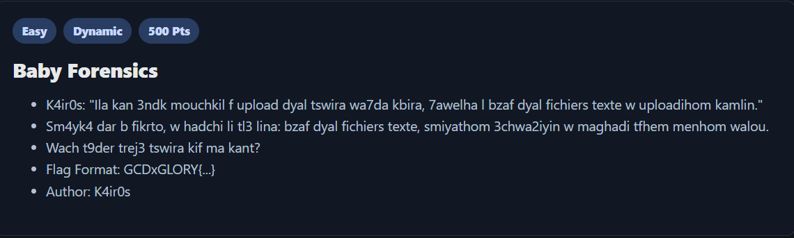
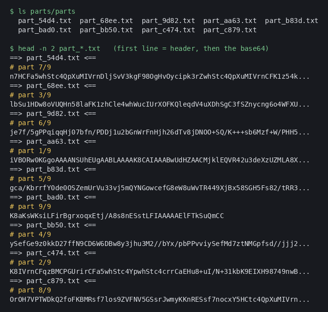
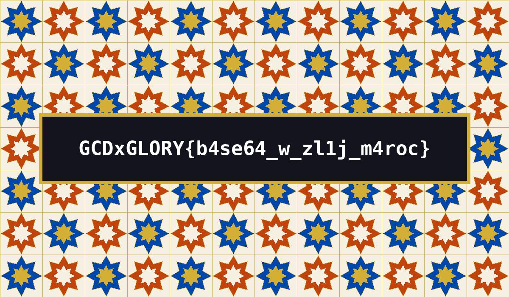

# Baby Forensics

| | |
|---|---|
| **Category** | Forensics |
| **Difficulty** | Easy |
| **Type** | Dynamic |
| **Points** | 500 |
| **Author** | K4ir0s |
| **Flag** | `GCDxGLORY{b4se64_w_zl1j_m4roc}` |

## Description



> K4ir0s: "Ila kan 3ndk mouchkil f upload dyal tswira wa7da kbira, 7awelha l bzaf dyal fichiers texte w uploadihom kamlin."
>
> Sm4yk4 dar b fikrto, w hadchi li tl3 lina: bzaf dyal fichiers texte, smiyathom 3chwa2iyin w maghadi tfhem menhom walou.
>
> Wach t9der trej3 tswira kif ma kant?

*(Translation: K4ir0s: "If you have a problem uploading one big picture, convert it to many text files and upload them all." Sm4yk4 followed his idea, and this is what we got: many text files with random names, and you will not understand anything from them. Can you get the picture back as it was?)*

**Flag format:** `GCDxGLORY{...}`

## Files

- [`files/parts.7z`](files/parts.7z): a 7-Zip archive with 9 text files (`parts/parts/part_xxxx.txt`)

## TL;DR

1. The archive holds **9 text files** with **random names** (`part_54d4.txt`, `part_aa63.txt`...). Sorting them by name gives garbage.
2. The first line of each file is a header, `# part N/9`: the real order is **inside the file**, not in its name.
3. The rest of each file is **base64**. Part 1 starts with `iVBORw0KGgo`, which is the base64 of the PNG signature.
4. Remove the headers, join the parts in the order 1 to 9, decode the base64, and save the result as a `.png`.
5. The flag is written in the banner of the picture.

---

## Solution

### Step 1: Extract the archive and look at the files

```
$ 7z x parts.7z
$ ls parts/parts
part_54d4.txt  part_68ee.txt  part_9d82.txt  part_aa63.txt  part_b83d.txt
part_bad0.txt  part_bb50.txt  part_c474.txt  part_c879.txt
```

(The archive contains a `parts` folder inside another `parts` folder.)

The file names are random hexadecimal. They tell nothing about the order, so `cat *.txt` does not work. Look at the beginning of each file:



Each file starts with a one-line header and then a long block of letters, digits, `+` and `/`.

### Step 2: Find the order

The header of each file gives the part number and the total:

```
# part 7/9     <- file part_54d4.txt
# part 3/9     <- file part_68ee.txt
# part 6/9     <- file part_9d82.txt
# part 1/9     <- file part_aa63.txt
...
```

| Part | File | Size of the base64 |
|---|---|---|
| 1 | `part_aa63.txt` | 6000 characters |
| 2 | `part_c474.txt` | 6000 |
| 3 | `part_68ee.txt` | 6000 |
| 4 | `part_bb50.txt` | 6000 |
| 5 | `part_b83d.txt` | 6000 |
| 6 | `part_9d82.txt` | 6000 |
| 7 | `part_54d4.txt` | 6000 |
| 8 | `part_c879.txt` | 6000 |
| 9 | `part_bad0.txt` | 52 |

Parts 1 to 8 are 6000 characters long, and the last part is the short end of the data.

### Step 3: Recognize base64 and the PNG

The text uses only `A-Z a-z 0-9 + /` (and `=` for padding at the end): this is **base64**.

Two clues tell what it contains:

- Part 1 starts with `iVBORw0KGgo`. This is the base64 of `\x89PNG\r\n\x1a\n`, the **signature of a PNG file**.
- Part 9 ends with `AAAAAElFTkSuQmCC`, the base64 of the PNG **`IEND`** chunk, which closes every PNG.

So the 9 pieces are one PNG file, cut in pieces, in base64.

### Step 4: Rebuild the picture

Remove the header of each file, join the base64 in the order 1 to 9, and decode it.

With a shell one-liner (run it in `parts/parts`):

```bash
for i in $(seq 1 9); do
  f=$(grep -l "^# part $i/9$" *.txt)     # the file whose header says "part i"
  tail -n +2 "$f"                        # its content without the header
done | tr -d '\n' | base64 -d > solved.png
```

Or with CyberChef: paste the 9 blocks in order (no header, no new line between them), *From Base64*, then *Render Image*.

Check the result:

```
$ file solved.png
solved.png: PNG image data, 1200 x 700, 8-bit/color RGB, non-interlaced
```

Notes:

- The pieces of 6000 characters are a multiple of 4, so every piece is a valid base64 block by itself, but the order still matters.
- A wrong order, for example sorting by file name, gives bytes that do not look like a PNG at all.

### Step 5: Read the flag

Open `solved.png`: a zellige-style pattern with a black banner in the middle.



```
GCDxGLORY{b4se64_w_zl1j_m4roc}
```

## Solver

[`solve/solve.py`](solve/solve.py) reads the headers, orders the parts, decodes the base64 and checks that the result is a PNG. It accepts the `.7z` archive (it needs `py7zr`) or the folder with the extracted `.txt` files.

```
$ pip install py7zr
$ cd solve
$ python3 solve.py ../files/parts.7z
9 parts -> solved.png (36039 bytes). Open it to read the flag.
```

## Flag

```
GCDxGLORY{b4se64_w_zl1j_m4roc}
```

## Main Ideas For This Chall

- **Base64 is an encoding, not encryption:** it turns any file (picture, video...) into text, and anybody can reverse it.
- **Recognize the start of a file in base64:** `iVBORw0KGgo` is a PNG. The *magic bytes* of a file type give a known base64 prefix.
- **The file name is not reliable:** the real order of the pieces is in the **content** (here, the first line).
- **Rebuild a file from fragments:** order, clean, concatenate, decode, then check the result with `file`.

## Tools used

- `7z` / `py7zr`
- `head`, `grep`, `tr`, `base64`
- CyberChef (*From Base64*, *Render Image*) as an alternative
- Python 3
- `file` and an image viewer
