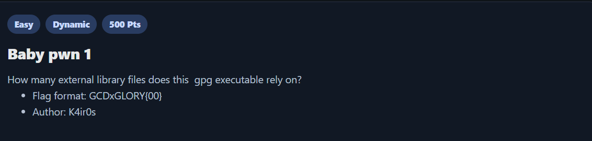

# Baby Forensics

| | |
|---|---|
| **Category** | Pwn |
| **Difficulty** | Easy |
| **Type** | Dynamic |
| **Points** | 500 |
| **Author** | K4ir0s |
| **Flag** | `GCDxGLORY{13}
` |

## Description



> How many external library files does this GPG executable rely on?

**Flag format:** `GCDxGLORY{...}`

## Files

- [`files/parts.7z`](gpg): Challenge executable.

## Solution

The challenge provides a Linux executable named `gpg`.

We can use the `ldd` command to list the shared libraries required by
the executable at runtime.

``` bash
ldd gpg
```

### Step 2 --- Count the dependencies

To count the lines returned by `ldd`, pipe its output into `wc -l`:

``` bash
ldd gpg | wc -l
```

The command returns:

``` text
13
```

### Step 3 --- Retrieve the flag

The result gives us the number required by the challenge.

**Flag:**

``` text
GCDxGLORY{13}
```

## Final Flag

`GCDxGLORY{13}`

## Tools Used

-   `ldd` --- Displays the shared-library dependencies of a dynamically
    linked executable.
-   `wc -l` --- Counts the number of lines in command output.
