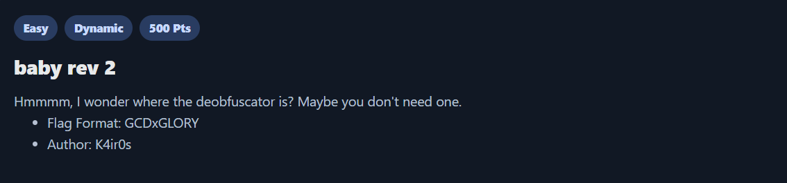
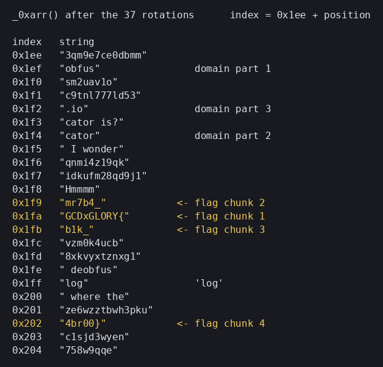
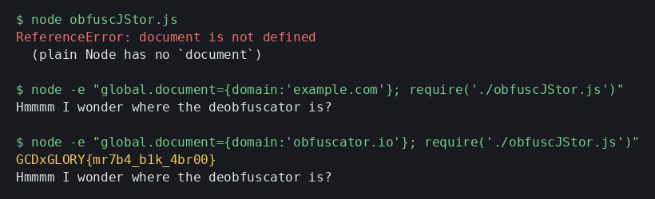

# baby rev 2

| | |
|---|---|
| **Category** | Reverse Engineering |
| **Difficulty** | Easy |
| **Type** | Dynamic |
| **Points** | 500 |
| **Author** | K4ir0s |
| **Flag** | `GCDxGLORY{mr7b4_b1k_4br00}` |

## Description



> Hmmmm, I wonder where the deobfuscator is? Maybe you don't need one.

**Flag format:** `GCDxGLORY{...}`

## Files

- [`files/obfuscJStor.js`](files/obfuscJStor.js): one obfuscated JavaScript file

## TL;DR

1. The script only prints the flag when `document.domain` is `obfuscator.io`. Everywhere else it prints `Hmmmm I wonder where the deobfuscator is?`.
2. The obfuscation hides the code, but **all the data is in one string array**, and the flag is in it in four chunks mixed with decoy strings.
3. Three ways to solve it, with no need to deobfuscate everything: **read the array**, **fake the domain** so that the script prints the flag itself, or **call the decoder** on the right indexes.

---

## Solution

### Step 1: Look at the script

The whole script is 4 pieces on a single line:

| Piece | Role |
|---|---|
| `function _0xarr(){ var _0xa=[ ... ]; ... }` | returns an array of 23 strings, all written with `\xNN` hex escapes |
| `(function(_0xs,_0xn){ ... })(_0xarr,0x25)` | rotates that array **37 times** (`0x25`) before anything uses it |
| `function _0xd(_0xi,_0xj){ ... }` | the decoder: returns element `i - 0x1ee` of the rotated array |
| `function hi(){ ... } hi();` | the real logic |

The `\xNN` escapes only hide the text from a quick read. In a text editor, a hex-escape decoder (CyberChef *Unescape string*, or a JavaScript console) shows it:

```
'\x47\x43\x44\x78\x47\x4c\x4f\x52\x59\x7b'  ->  GCDxGLORY{
'\x6d\x72\x37\x62\x34\x5f'                  ->  mr7b4_
```

### Step 2: Understand `hi()`

With the strings decoded, `hi()` reads:

```js
function hi() {
  document['domain'] == "obfus" + "cator" + ".io"
    && console.log( FLAG_CHUNK_1 + FLAG_CHUNK_2 + FLAG_CHUNK_3 + FLAG_CHUNK_4 ),
  console.log("Hmmmm" + " I wonder" + " where the" + " deobfus" + "cator is?");
}
hi();
```

Two things to notice:

- The first `console.log` (the flag) is behind `&&`: it runs only if `document.domain == "obfuscator.io"`.
- The second `console.log` is after a **comma**, so it runs **every time**. On `obfuscator.io` the script prints the flag **and** the `Hmmmm` message; anywhere else it prints only `Hmmmm`.

In the obfuscated source, these strings are `_0xd(...)` calls:

```js
document['\x64\x6f\x6d\x61\x69\x6e'] == _0xd(0x1ef)+_0xd(0x1f4)+_0xd(0x1f2)
  && console[_0xd(0x1ff)](_0xd(0x1fa)+_0xd(0x1f9)+_0xd(0x1fb)+_0xd(0x202)),
console[_0xd(0x1ff)](_0xd(0x1f8)+_0xd(0x1f5)+_0xd(0x200)+_0xd(0x1fe)+_0xd(0x1f3));
```

### Step 3: The string array

After the 37 rotations (23 strings, so it is the same as 14 rotations), `_0xd(i)` returns the string at position `i - 0x1ee`. The whole array, with the indexes used by `hi()`:



| `_0xd(...)` | String | Used for |
|---|---|---|
| `0x1ef`, `0x1f4`, `0x1f2` | `obfus`, `cator`, `.io` | the domain `obfuscator.io` |
| `0x1ff` | `log` | the name of `console.log` |
| `0x1fa` | `GCDxGLORY{` | flag chunk 1 |
| `0x1f9` | `mr7b4_` | flag chunk 2 |
| `0x1fb` | `b1k_` | flag chunk 3 |
| `0x202` | `4br00}` | flag chunk 4 |
| `0x1f8`, `0x1f5`, `0x200`, `0x1fe`, `0x1f3` | `Hmmmm`, ` I wonder`, ` where the`, ` deobfus`, `cator is?` | the message printed everywhere |

The other 10 strings (`3qm9e7ce0dbmm`, `sm2uav1o`, ...) are random **decoys** and are never used.

### Solution 1: read the array

Decode the hex escapes in the array, find the four chunks (they start with `GCDxGLORY{` and end with `}`), and use the indexes in `hi()` to put them in the right order:

```
_0xd(0x1fa) + _0xd(0x1f9) + _0xd(0x1fb) + _0xd(0x202)
= GCDxGLORY{ + mr7b4_ + b1k_ + 4br00}
```

### Solution 2: make the check pass

The script prints the flag itself if `document.domain` is `obfuscator.io`.

**In Node.js.** A plain `node obfuscJStor.js` fails, because Node has no `document`. Define it first:

```js
global.document = { domain: 'obfuscator.io' };
require('./obfuscJStor.js');
```



**In a browser console,** before pasting the script:

```js
Object.defineProperty(document, 'domain', { get: () => 'obfuscator.io' });
```

then paste the script: it prints the flag.

*(The Node.js runs above were tested on the real file. The browser version was not tested here.)*

### Solution 3: decode it yourself

Load the script without calling `hi()`, then use the array and the offset `0x1ee`:

```js
const off = 0x1ee;
const arr = _0xarr();                       // already rotated
const order = [0x1fa, 0x1f9, 0x1fb, 0x202];
console.log(order.map(i => arr[i - off]).join(''));
```

### Run the solver

[`solve/solve.js`](solve/solve.js) does solutions 2 and 3 with Node's `vm` module (the sandbox has a fake `document`, and the script never touches your real environment):

```
$ cd solve
$ node solve.js ../files/obfuscJStor.js
[1] fake document.domain -> GCDxGLORY{mr7b4_b1k_4br00} | Hmmmm I wonder where the deobfuscator is?
[2] indexes 0x1fa 0x1f9 0x1fb 0x202 -> GCDxGLORY{mr7b4_b1k_4br00}
```

## Flag

```
GCDxGLORY{mr7b4_b1k_4br00}
```

## Main Ideas For This Chall

- **Obfuscation is not protection:** it hides the *intent* of the code, not its *data*. The flag is in the file in clear, once the escapes are decoded.
- **Hex escapes** (`\x47\x43...`) and a **string array with rotation and an index offset**: a very common pattern in obfuscated JavaScript.
- **Read the logic, not the noise:** `A && B, C` means `B` only runs when `A` is true, and `C` always runs.
- **Dynamic analysis beats static analysis:** instead of reversing everything, **change the environment** (here `document.domain`) and let the program print the secret.
- **Use the program's own functions** (`_0xarr`, `_0xd`) to decode its data.
- When running unknown scripts, use an isolated environment (a sandbox, `vm`, a VM).

## Tools used

- Node.js and a browser console
- A text editor, CyberChef (*Unescape string*)
