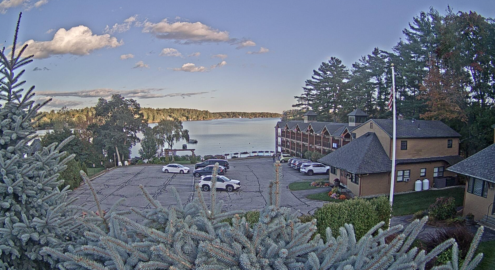
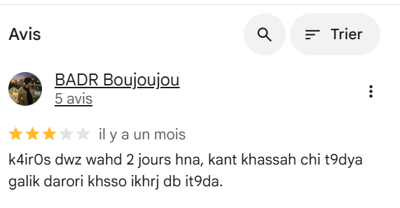
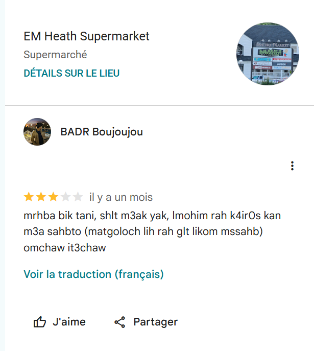
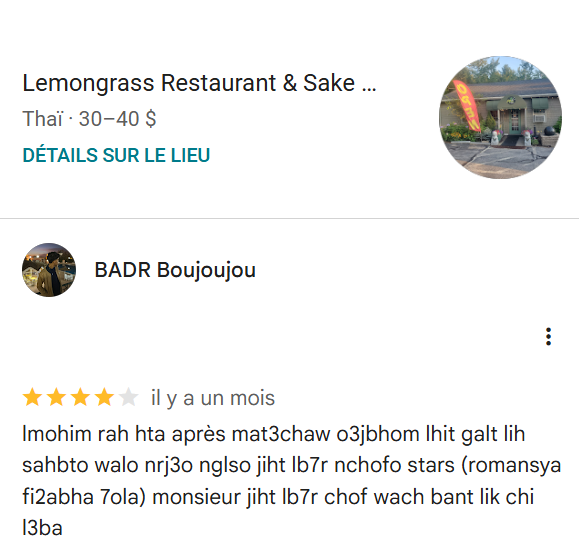
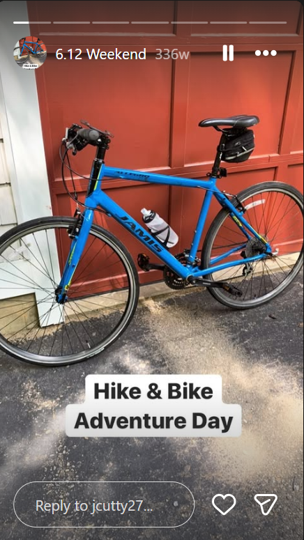

# haaa9 mchaaa

| | |
|---|---|
| **Category** | OSINT |
| **Difficulty** | Easy |
| **Type** | Dynamic |
| **Points** | 500 |
| **Author** | K4ir0s |
| **Flag** | `GCDxGLORY{Center_Harbor_Inn, +16032538100, Jamis, Center_Harbor_Town_Beach}` |

## Description

> k4ir0s tl3at lih l9raya frasso gal aji nmchi nmchi nbdl ljow chwia hz passport
> dialo ovisa (wakha ma3ndoch) ohowa i9ssd whad l9nt.wsslo lblasaa lach mcha
> oghatfhmo kolchi.

*(Rough translation: k4ir0s was tired of studying, said "let me go change the air
a bit", grabbed his passport and visa (even though he doesn't have one), and
headed to this place. Find where he went and you'll understand everything.)*

**Flag format:** `GCDxGLORY{Smya_Dial_Hotel, Numdialrestau, MarqueDeVeloDialCEO, smit_lbeach}`

| Flag part | Meaning |
|---|---|
| `Smya_Dial_Hotel` | Name of the hotel |
| `Numdialrestau` | Phone number of the restaurant |
| `MarqueDeVeloDialCEO` | Bike brand of the CEO |
| `smit_lbeach` | Name of the beach |

**Hint (released during the event):** try to find reviews of *badr boujoujou* in
the locations.

## Files

Players receive one image, a webcam capture of the place where k4ir0s is staying:



## Solution

The challenge is a chain. The webcam image gives the first location, and each
Google Maps review left by the account **BADR Boujoujou** points to the next
step.

### Step 1: Identify the hotel

The image is a view over a parking lot toward a lake. On the right there is a
multi-storey wooden hotel with small turrets (cupolas) on the roof, and an
American flag stands in front of it. It looks like a hotel webcam.

`TODO: add how you identified it (reverse image search / Google Lens /
Maps satellite view)`

The place is the **Center Harbor Inn** in Center Harbor, New Hampshire, USA, on
Lake Winnipesaukee.

→ `Center_Harbor_Inn`

### Step 2: Follow the reviews, starting with the parking lot

On Google Maps, the exact parking lot shown in the image is listed as the
**Lake Winni Wake Fest** place. Following the hint, I looked at the reviews of
BADR Boujoujou there:



> *k4ir0s dwz wahd 2 jours hna, kant khassah chi t9dya galik darori khsso ikhrj
> db it9da.*
> (k4ir0s spent two days here; he needed to do some shopping, so he had to go out
> and get it done.)

So k4ir0s went shopping in the town's supermarket.

### Step 3: EM Heath Supermarket

The supermarket nearby is **EM Heath Supermarket**. It has another review by the
same account:



> *mrhba bik tani, shlt m3ak yak, lmohim rah k4ir0s kan m3a sahbto (matgoloch lih
> rah glt likom mssahb) omchaw it3chaw*
> (Welcome again, I got you, didn't I? Anyway, k4ir0s was with his girlfriend
> (don't tell him I told you) and they went to have dinner.)

So the next place is a restaurant.

### Step 4: Lemongrass Restaurant & Sake Bar

The restaurant is **Lemongrass Restaurant & Sake Bar | Thai • Sushi**. Its
review by BADR Boujoujou:



> *lmohim rah hta apres mat3chaw o3jbhom lhit galt lih sahbto walo nrj3o nglso
> jiht lb7r nchofo stars (romansya fi2abha 7ola) monsieur jiht lb7r chof wach
> bant lik chi l3ba.*
> (Anyway, even after dinner they liked it, and his girlfriend said let's go sit
> by the lake and watch the stars (romantic, in her mind). As for him: go to the
> lake and see if anything shows up for you.)

Two things come from this review:
- The **phone number** of this restaurant is the second part of the flag:
  `+16032538100`.
- The review sends us to the lake side, to the next question.

### Step 5: The beach

The hotel's beach is the **Center Harbor Town Beach**, the place by the lake
where they went to watch the stars.

→ `Center_Harbor_Town_Beach`

### Step 6: The CEO's bike brand

The last part asks for the bike brand of the CEO. The person is
**Justin Cutill**, co-CEO of `TODO: the company, e.g. the inn / restaurant`.
His Instagram account is **`jcutty27`**. In his **highlights** there is a story
showing his bike, and the brand is **Jamis**.



→ `Jamis`

## Putting it together

| Flag part | Answer | Source |
|---|---|---|
| Hotel name | `Center_Harbor_Inn` | Webcam image |
| Restaurant number | `+16032538100` | Lemongrass Restaurant & Sake Bar |
| CEO's bike brand | `Jamis` | Instagram `@jcutty27`, highlights |
| Beach name | `Center_Harbor_Town_Beach` | Beach of the hotel |

## Flag

```
GCDxGLORY{Center_Harbor_Inn, +16032538100, Jamis, Center_Harbor_Town_Beach}
```

## Tools used

- Google Maps and Google Maps reviews
- Reverse image search (Google Lens)
- Instagram
