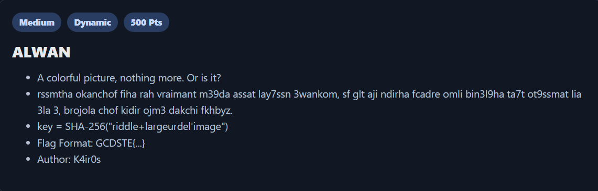
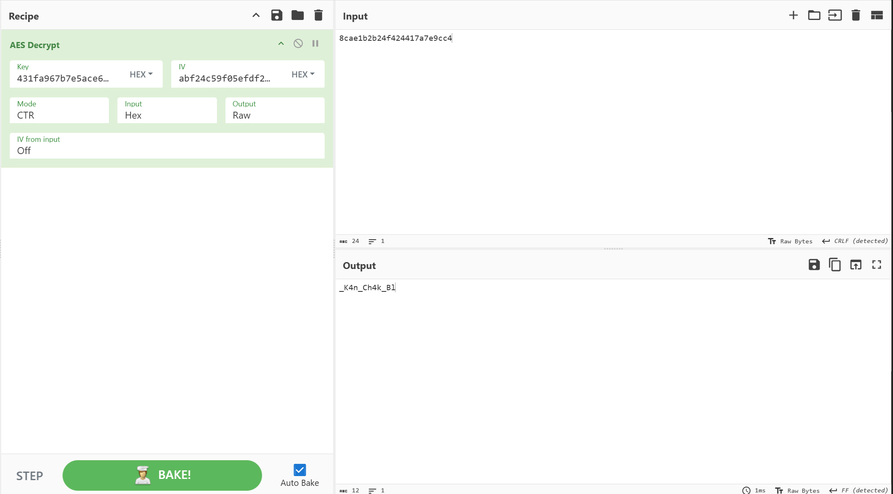
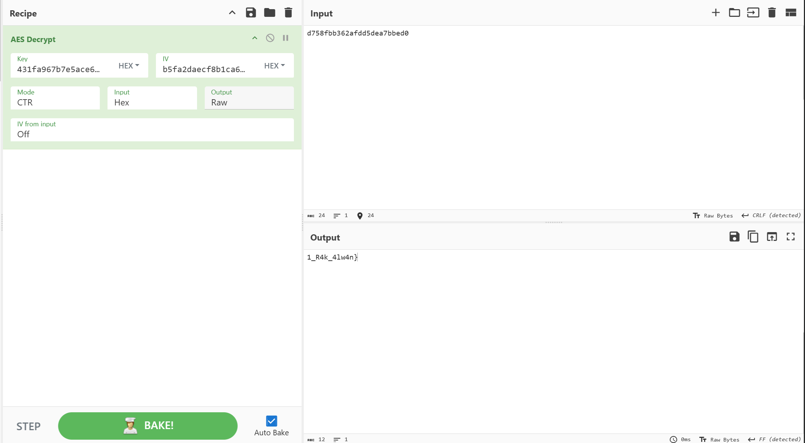

# ALWAN

| | |
|---|---|
| **Category** | Steganography |
| **Difficulty** | Medium |
| **Type** | Dynamic |
| **Points** | 500 |
| **Author** | K4ir0s |
| **Flag** | `GCDSTE{k4ir0s_K4n_Ch4k_Bl1_R4k_4lw4n}` |

## Description



> A colorful picture, nothing more. Or is it?
>
> rssmtha okanchof fiha rah vraimant m39da assat lay7ssn 3wankom, sf glt aji ndirha fcadre omli bin3l9ha ta7t ot9ssmat lia 3la 3, brojola chof kidir ojm3 dakchi fkhbyz.
>
> key = SHA-256("riddle+largeurdel'image")

**Flag format:** `GCDSTE{...}`

## Files

- [`files/4lw4n.bmp`](files/4lw4n.bmp): a 640 x 480 colorful BMP image
- [`files/riddle.txt`](files/riddle.txt): a riddle in Darija

```
ha wahd riddle fkhbyz tani:
kanban b3d chta, okanlbs 7 tlwan
kolma 9rbty kanb3d
ma3ndich rjlin walakin dima kanhrb
ila jity jihty, kankhtafy, l9itini?
iwa rah lhdra machi 3lia 3rb m3aya chwia.
```

*(Translation of the first lines: I appear after the rain, and I wear 7 colors. The closer you get, the further I go. I have no legs, but I always run away. If you come my way, I disappear. Did you find me?)*

**Hint released during the event:** the riddle's answer is `4lw4n`.

## TL;DR

1. `exiftool` shows two "almost normal" DPI values. Their lowest bytes are **17** and **5**: the *stride* and the *start* of a hidden LSB pattern.
2. `strings` shows **5 unlabeled lines** at the end of the file: 3 base64 and 2 hex. Only one base64 line is real: it gives **part 1**.
3. The riddle's answer (`4lw4n`) + the image width (`640`) gives the AES key: `SHA-256("4lw4n640")`.
4. One of the two hex lines (IV + ciphertext) decrypts with that key to **part 2**. The other one gives noise.
5. The LSBs of one color byte out of 17, from byte 5, hold another IV + ciphertext. It decrypts to **part 3**.

---

## Solution

### Step 1: Look at the image metadata

```
$ file 4lw4n.bmp
4lw4n.bmp: PC bitmap, Windows 3.x format, 640 x 480 x 24, image size 921600, resolution 2833 x 2821 px/m, cbSize 921654, bits offset 54
```

Two things are strange:

- A normal 72 DPI image has **2835** pixels per meter. Here we have `2833` and `2821`: almost normal, so suspicious.
- The BMP header says the file should be `921654` bytes (54 + 921600), but the real file is **921883** bytes. Some data is appended after the pixels.

Each DPI value hides one byte: the **lowest byte** (value modulo 256).

| Field | Value | mod 256 | Use |
|---|---|---|---|
| Pixels Per Meter X | 2833 | **17** | stride |
| Pixels Per Meter Y | 2821 | **5** | start |

Also write down the image width: **640**.

> **Why not 72 DPI?** Values that look normal are more suspicious than absurd values: a player who skips them cannot find the LSB pattern in step 5.

### Step 2: Read the end of the file

```
$ strings 4lw4n.bmp | tail -5
b659b006738a3ac9df4857b7f0dbda4786b6c135581c61cb3960039d
abf24c59f05efdf2aa685141ee29a57d8cae1b2b24f424417a7e9cc4
Z2xiXzZfOV9tYWtheW5fdzRsMF9objQ=
R0NEU1RFe2s0aXIwcw==
bDRhbHc0bl9kMG50X2wxZV9idXRfcDF4ZWxzX2FoaA==
```

Five lines, **no labels**. Decode all of them:

| Line | Type | Decoded | Verdict |
|---|---|---|---|
| `b659b006...039d` | hex (56 chars = 28 bytes) | needs a key | decoy (step 4) |
| `abf24c59...9cc4` | hex (56 chars = 28 bytes) | needs a key | **part 2** (step 4) |
| `Z2xiXzZfOV9t...` | base64 | `glb_6_9_makayn_w4l0_hn4` | decoy |
| `R0NEU1RFe2s0aXIwcw==` | base64 | `GCDSTE{k4ir0s` | **part 1** |
| `bDRhbHc0bl9k...` | base64 | `l4alw4n_d0nt_l1e_but_p1xels_ahh` | decoy |

Only the line starting with `GCDSTE{` is the real beginning of the flag. The other two base64 lines are decoys, and they say it themselves.

### Step 3: Build the key

The challenge text gives the recipe: `key = SHA-256("riddle+largeurdel'image")`, that is **riddle answer + image width** (*largeur* = width).

- Riddle answer: **`4lw4n`** (*Alwan* means *colors* in Arabic, but I actually meant LGBTQ+ when I used it in Darija, and the riddle describes a rainbow(So I hope you understood what I meant). This is also the file name, and the hint released during the event.
- Width: **`640`** (from step 1).

In CyberChef, `4lw4n640` with **SHA2 (size 256)**:

```
431fa967b7e5ace6f2127dd7c8d6d3b1731d6b1a34867f3fbaf2f09371cf6303
```

### Step 4: Decrypt part 2 (the hex lines)

Each hex line is 28 bytes: **16 bytes of IV + 12 bytes of ciphertext**. The cipher is **AES-256 in CTR mode**.

For `abf24c59f05efdf2aa685141ee29a57d8cae1b2b24f424417a7e9cc4`:

| Part | Value |
|---|---|
| IV (first 16 bytes) | `abf24c59f05efdf2aa685141ee29a57d` |
| Ciphertext (last 12 bytes) | `8cae1b2b24f424417a7e9cc4` |

CyberChef recipe, input = ciphertext in hex:

```
AES_Decrypt({'option':'Hex','string':'431fa967b7e5ace6f2127dd7c8d6d3b1731d6b1a34867f3fbaf2f09371cf6303'},{'option':'Hex','string':'abf24c59f05efdf2aa685141ee29a57d'},'CTR','Hex','Raw',{'option':'Hex','string':''},{'option':'Hex','string':''})
```



Result: `_K4n_Ch4k_Bl` (**part 2**). The same recipe on the other hex line (`b659b006...`) gives only random bytes: it is the decoy.

### Step 5: Extract the LSBs (part 3)

The image looks like a plain color gradient, but `zsteg -a` finds nothing useful. The reason: the hidden bits are **not consecutive**. They are the least significant bits of **one color byte out of 17**, starting at byte **5** (the two numbers of step 1), in **B, G, R** order, row by row from the top, most significant bit first.

```
positions: 5, 22, 39, 56, 73, ...   (5 + 17 x n)
```

All the other bytes are random noise, so a normal left-to-right LSB read returns garbage.

We need 28 bytes (16 IV + 12 ciphertext) = 224 bits:

```python
import numpy as np
from PIL import Image

stride, start, nbytes = 17, 5, 28
px = np.array(Image.open("4lw4n.bmp").convert("RGB"))
flat = px[..., ::-1].reshape(-1)          # B, G, R order
bits = flat[start : start + nbytes * 8 * stride : stride] & 1
print(np.packbits(bits).tobytes().hex())
```

Output:

```
b5fa2daecf8b1ca6ed41a903a97254abd758fbb362afdd5dea7bbed0
```

| Part | Value |
|---|---|
| IV | `b5fa2daecf8b1ca6ed41a903a97254ab` |
| Ciphertext | `d758fbb362afdd5dea7bbed0` |

Same CyberChef recipe as step 4, with this IV and this ciphertext:

```
AES_Decrypt({'option':'Hex','string':'431fa967b7e5ace6f2127dd7c8d6d3b1731d6b1a34867f3fbaf2f09371cf6303'},{'option':'Hex','string':'b5fa2daecf8b1ca6ed41a903a97254ab'},'CTR','Hex','Raw',{'option':'Hex','string':''},{'option':'Hex','string':''})
```



Result: `1_R4k_4lw4n}` (**part 3**).

<details>
<summary><b>Step 5 explained simply (click to open)</b></summary>

**1. An image is just numbers.** Each pixel is 3 numbers between 0 and 255 (Blue, Green, Red). A 640 x 480 image gives a very long list of numbers. In the script this list is called `flat`, read in B, G, R order, row by row.

```
pixel 1 : B=153  G=87   R=210
pixel 2 : B=154  G=88   R=211
...
```

**2. The last bit (LSB).** Every number is written in binary, for example `153 = 10011001`. The last bit (here `1`) changes the color so little that nobody sees a difference. This is where data is hidden: one bit per number.

**3. Why `zsteg` finds nothing.** A classic LSB reads the last bit of all numbers in a row: 1st, 2nd, 3rd, 4th... Here only **one number out of 17** is used, starting at the **5th**: positions `5 + 17 x 0`, `5 + 17 x 1`, `5 + 17 x 2`... All the other positions hold random bits, so reading everything in a row gives noise. The numbers 17 and 5 come from step 1 (low bytes of 2833 and 2821).

**4. The script, line by line.**

| Line | What it does |
|---|---|
| `stride, start, nbytes = 17, 5, 28` | skip 17 by 17, start at position 5, we want 28 bytes (16 IV + 12 ciphertext) |
| `px = np.array(Image.open("4lw4n.bmp").convert("RGB"))` | opens the image as an array of pixels |
| `flat = px[..., ::-1].reshape(-1)` | `::-1` turns R,G,B into B,G,R, and `reshape(-1)` flattens everything into one line |
| `bits = flat[start : start + nbytes * 8 * stride : stride] & 1` | takes 1 number out of 17 from the 5th, and `& 1` keeps only the last bit (28 x 8 = 224 bits) |
| `np.packbits(bits).tobytes().hex()` | groups the bits by 8 to make bytes, and prints them in hex |

**5. How to run it.** Save the script as `extract.py` next to `4lw4n.bmp`, install the modules if needed (`pip install pillow numpy`), then run `python3 extract.py`.

**6. The result** is 56 hex characters, i.e. 28 bytes, split in two: a 16-byte IV (`b5fa2dae...54ab`) and a 12-byte ciphertext (`d758fbb3...bed0`).

**7. Decrypt in CyberChef** with the key from step 3 and the operation *AES Decrypt*: Key = the hex key (`431fa967...6303`), IV = the IV above, Mode = CTR, Input = Hex, Output = Raw. Paste `d758fbb362afdd5dea7bbed0` as input and you get `1_R4k_4lw4n}`.

</details>

### Step 6: Assemble the flag

| Part | Source | Value |
|---|---|---|
| 1 | base64 line at the end of the file | `GCDSTE{k4ir0s` |
| 2 | hex line + AES-CTR | `_K4n_Ch4k_Bl` |
| 3 | pixel LSBs + AES-CTR | `1_R4k_4lw4n}` |

```
GCDSTE{k4ir0s_K4n_Ch4k_Bl1_R4k_4lw4n}
```

## Solver

The original French writeup of the challenge is also kept in [`writeup/Writeup_Colors_v2.pdf`](writeup/Writeup_Colors_v2.pdf).

[`solve/solve.py`](solve/solve.py) runs the whole chain (header, appended lines, key, decryption, LSB extraction) and prints the flag. It needs `numpy`, `pillow`, and one of `cryptography`, `pycryptodome` or the `openssl` binary.

```
$ cd solve
$ python3 solve.py ../files/4lw4n.bmp
[1] width=640 ppmX=2833 ppmY=2821 -> stride=17 start=5
[2] 5 unlabeled lines after the BMP data
[3] key = 431fa967b7e5ace6f2127dd7c8d6d3b1731d6b1a34867f3fbaf2f09371cf6303
[4] hex b659b006... -> b'\xf8\xe1\n\x94EV;f\x03\xa3\x9e\xb5'  [decoy (noise)]
[4] hex abf24c59... -> b'_K4n_Ch4k_Bl'  [REAL]
[2] base64 Z2xiXzZfOV9t... -> glb_6_9_makayn_w4l0_hn4  [decoy]
[2] base64 R0NEU1RFe2s0... -> GCDSTE{k4ir0s  [REAL]
[2] base64 bDRhbHc0bl9k... -> l4alw4n_d0nt_l1e_but_p1xels_ahh  [decoy]
[5] LSB blob = b5fa2daecf8b1ca6ed41a903a97254abd758fbb362afdd5dea7bbed0
    -> 1_R4k_4lw4n}

FLAG: GCDSTE{k4ir0s_K4n_Ch4k_Bl1_R4k_4lw4n}
```

## Flag

```
GCDSTE{k4ir0s_K4n_Ch4k_Bl1_R4k_4lw4n}
```

## Main Ideas For This Chall

- **Metadata can hide data.** Values that look normal (DPI) can carry a byte each. Always compare header fields with what a "normal" file would have.
- **Check the end of the file.** Data after the declared file size (`cbSize`) is invisible to image viewers but easy to find with `strings`.
- **Decode every line.** Some of them are decoys.
- **Keys can be derived, not stored.** Here the key comes from the riddle answer and an image property.
- **LSB is not always consecutive.** Tools like `zsteg` only know classic patterns: when they find nothing, write your own extraction with a custom stride and start.
- **Never recompress the image.** JPEG or social-media compression destroys LSBs.

## Tools used

- `file`, `exiftool`, `strings`
- CyberChef (From Base64, SHA2, AES Decrypt)
- `zsteg` (to see that classic LSB patterns fail)
- Python 3 (`numpy`, `pillow`)
