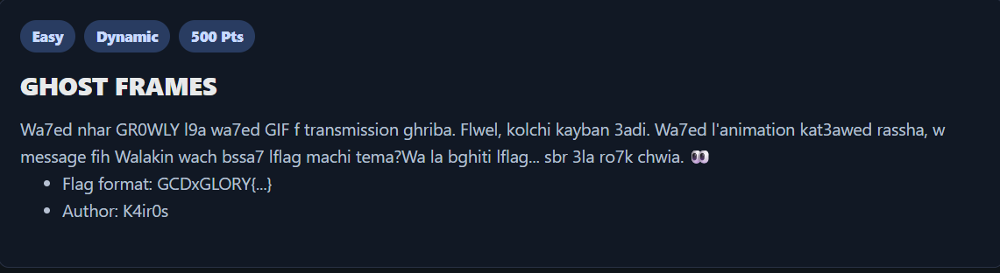
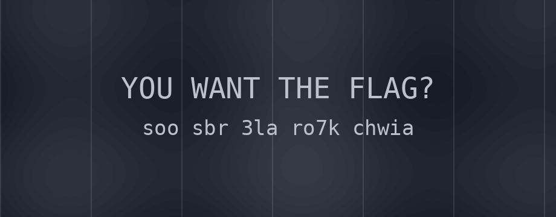
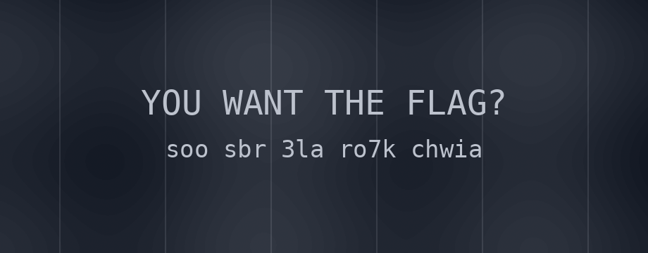
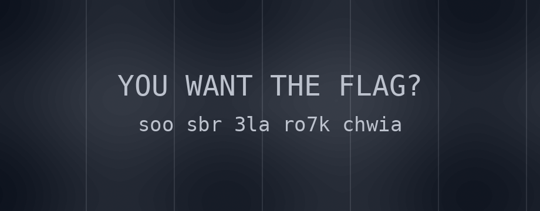
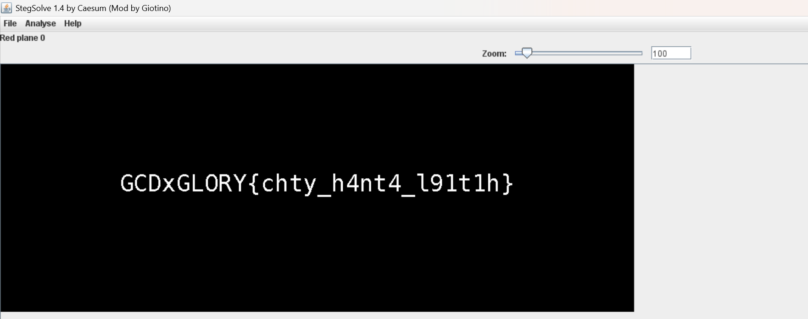
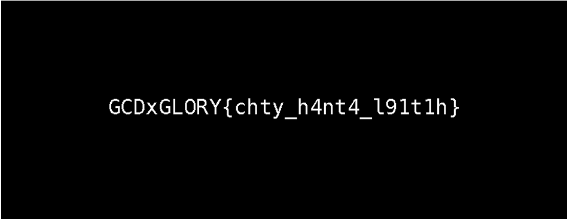

# GHOST FRAMES

| | |
|---|---|
| **Category** | Steganography |
| **Difficulty** | Easy |
| **Type** | Dynamic |
| **Points** | 500 |
| **Author** | K4ir0s |
| **Flag** | `GCDxGLORY{chty_h4nt4_l91t1h}` |

## Description



> Wa7ed nhar GR0WLY l9a wa7ed GIF f transmission ghriba. Flwel, kolchi kayban
> 3adi. Wa7ed l'animation kat3awed rassha, w message fih Walakin wach bssa7
> lflag machi tema? Wa la bghiti lflag... sbr 3la ro7k chwia.

*(Translation: One day GR0WLY found a GIF in a strange transmission. At first
everything looks normal. The animation loops on itself, and there is a message
in it. But is the flag really there? If you want the flag... be patient with
yourself a little.)*

**Flag format:** `GCDxGLORY{...}`

**Hint (released during the event):** try to solve it with StegSolve.

## Files

- [`files/ghost_frames.gif`](files/ghost_frames.gif): an animated GIF, 920 x 360 px, 11 frames

## TL;DR

The GIF hides the flag in **two frames (4 and 8)**. Each one hides a random-looking
picture in the **least significant bit (LSB) of the red channel**. Alone they are noise,
but if you **XOR** them together, the flag appears.

---

## Solution

### Step 1: Look at the GIF

Every frame shows the same text on a dark "signal monitor" background:



```
YOU WANT THE FLAG?
soo sbr 3la ro7k chwia      (= "so be a little patient")
```

Nothing else is visible. The description says the animation "loops on itself" and
asks to be patient, so the secret must be in the **frames** and not in the text. The
hint tells us to use **StegSolve**, a tool made to look at the bits of an image.

Quick checks that find nothing:
- `strings ghost_frames.gif | grep GCDx` gives nothing, the flag is not in clear text.
- `exiftool ghost_frames.gif` shows no useful comment or metadata.

### Step 2: Split the GIF into frames

A GIF is a list of images. We need each frame as a **PNG** (never JPEG, because JPEG
compression would destroy the tiny color changes we are looking for).

With **ezgif.com**: *GIF Splitter*, then choose **PNG** as output format and download the frames.
The site numbers them from 1 to 11.

Or with the command line:

```bash
ffmpeg -i ghost_frames.gif -vsync 0 frame_%02d.png
```

### Step 3: Spot the ghost frames

The frames look identical to the eye, but two of them are special. A simple check is to
look at the **red LSB plane** of every frame. In a normal frame it is empty (all zeros).
In frames **4** and **8** it is full of random noise (about 50% ones):

| Frame | Red LSB ones |
|---|---|
| 1, 2, 3, 5, 6, 7, 9, 10, 11 | 0.0% |
| **4** | **50%** |
| **8** | **50%** |

Seen alone, each of the two frames only gives noise:

| Frame 4, red plane 0 | Frame 8, red plane 0 |
|---|---|
|  |  |

These are two **shares** of a secret. Let `M` be the flag image. The author took a
random image `A` and computed `B = A XOR M`. Alone, `A` and `B` are random noise, but:

```
A XOR B = A XOR (A XOR M) = M
```

### Step 4: Combine frames 4 and 8 with StegSolve

1. Open **StegSolve** and open `frame_04.png` (**File → Open**).
2. Go to **Analyse → Image Combiner** and choose `frame_08.png`.
3. In the combiner window, use the arrows to select the **XOR** operation. Save the result with **Save As** (as PNG).
4. Open the saved result in StegSolve and use the arrows at the bottom to go to **Red plane 0**.

The flag appears in white on a black background:



> **Trap:** the normal RGB view after the XOR looks noisy and may still show parts of the animation. The flag is only readable in the **Red plane 0** view.
>
> **Trap:** exporting the frames as JPEG, or with a tool that changes the GIF palette, destroys the LSBs and makes the recovery impossible.

### Step 5 (alternative): Python script

The same idea in a few lines ([`solve/solve.py`](solve/solve.py)):

```python
from PIL import Image
import numpy as np

gif = Image.open("ghost_frames.gif")
shares = []
for i in (3, 7):                       # frames 4 and 8 (Python counts from 0)
    gif.seek(i)
    red = np.array(gif.convert("RGB"))[:, :, 0]
    shares.append(red & 1)             # keep only the red LSB

flag = (shares[0] ^ shares[1]) * 255   # XOR, then turn 0/1 into black/white
Image.fromarray(flag.astype("uint8")).save("flag.png")
```

```
$ python3 solve.py ghost_frames.gif
11 frames, size (920, 360)
...
noisy frames (1-based): [4, 8]
saved flag.png -> open it and read the flag
```

My `solve.py` also finds the two ghost frames on its own (the ones with ~50% ones in
the red LSB), so you don't need to know that they are frames 4 and 8.

The result `flag.png`:



## Flag

```
GCDxGLORY{chty_h4nt4_l91t1h}
```

## Main Ideas For This Chall

- A GIF is a **list of frames**, and each frame can hide something different.
- **LSB steganography**: changing the least significant bit of a color value is invisible to the eye.
- **XOR sharing**: two noise images can hide a message that only appears when they are combined.
- **Frame numbering**: tools count from 1, Python counts from 0 (frames 4 and 8 are indexes 3 and 7).
- Always export frames in a **lossless** format (PNG).

## Tools used

- [ezgif.com](https://ezgif.com/split): to split the GIF into frames
- [github.com](https://github.com/Giotino/stegsolve/releases): StegSolve (Image Combiner + bit planes)
- Python 3 with Pillow and NumPy (alternative)
