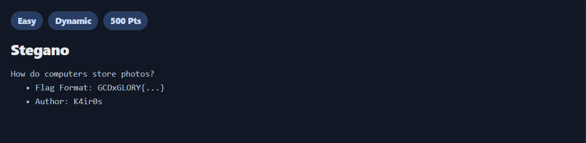
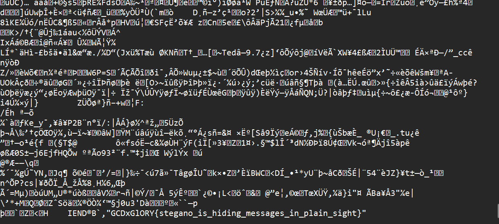

# Stegano

| | |
|---|---|
| **Category** | Steganography |
| **Difficulty** | Easy |
| **Type** | Dynamic |
| **Points** | 500 |
| **Author** | K4ir0s |
| **Flag** | `GCDxGlORY{stegano_is_hiding_messages_in_plain_sight}` |

## Description



> How do computers store photos?

**Flag format:** `GCDxGLORY{...}`

No hints were released during the event.

## Files

- [`files/steg.jpg`](files/steg.jpg)

## TL;DR

An image is just **bytes in a file**. The flag was appended at the very **end** of the file, after the end-of-image marker, so image viewers ignore it. Open the file as text (or run `strings`) and read the last line.

## Solution

### Step 1: Read the hint in the description

*"How do computers store photos?"* The answer is: as a **sequence of bytes**, just like any other file. So we should stop looking at the picture and look at the **file itself**.

### Step 2: Identify the file

The extension says `.jpg`, but extensions can lie. The first bytes of a file (the "magic bytes") tell the real format:

```
$ xxd steg.jpg | head -1
00000000: 8950 4e47 0d0a 1a0d ...     .PNG....
```

`89 50 4E 47` is the signature of a **PNG**, not a JPEG (a JPEG starts with `FF D8 FF`). So the file is a PNG with a `.jpg` name.

A PNG ends with a special chunk called **`IEND`**. Anything written after it is ignored by image viewers, which makes it a classic place to hide data.

### Step 3: Look at the end of the file

**Method 1: Notepad (the intended way)**

1. Right-click `steg.jpg` and choose **Open with → Notepad**.
2. The content is unreadable garbage, this is the raw image data.
3. Scroll all the way down (or press `Ctrl + End`). The last line is readable:



The text appears right after the `IEND` marker.

**Method 2: Command line**

```bash
strings steg.jpg | tail -n 1
```

```bash
tail -c 100 steg.jpg
```

**Method 3: Hex editor**

Open the file in HxD / ImHex and go to the end. The right side (ASCII column) shows the flag after the bytes `49 45 4E 44 AE 42 60 82` (`IEND` + its CRC).

### Step 4: Get the flag

The appended text is:

```
"GCDxGlORY{stegano_is_hiding_messages_in_plain_sight}"
```

## Flag

```
GCDxGlORY{stegano_is_hiding_messages_in_plain_sight}
```

## What players should learn

- A file's extension is only a name, the **magic bytes** show its real type.
- Data placed **after the end marker** of a file (`IEND` for PNG, `FF D9` for JPEG) is invisible to viewers but still in the file.
- Always try simple things first on a stego challenge: `file`, `strings`, `tail`, a hex editor.

## Tools used

- Notepad (or any text editor)
- `strings`, `tail`, `xxd`
- A hex editor (optional)
