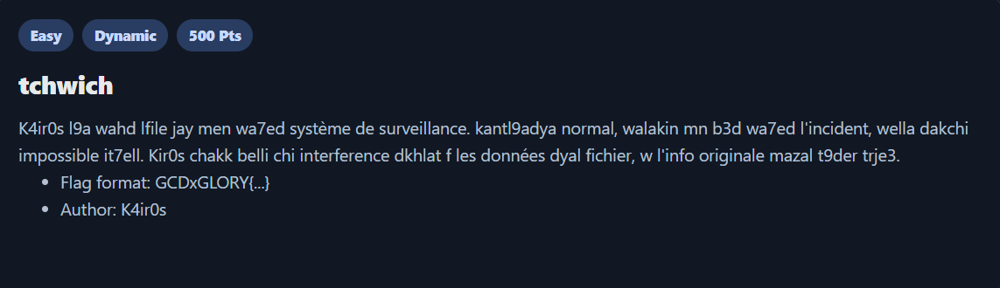
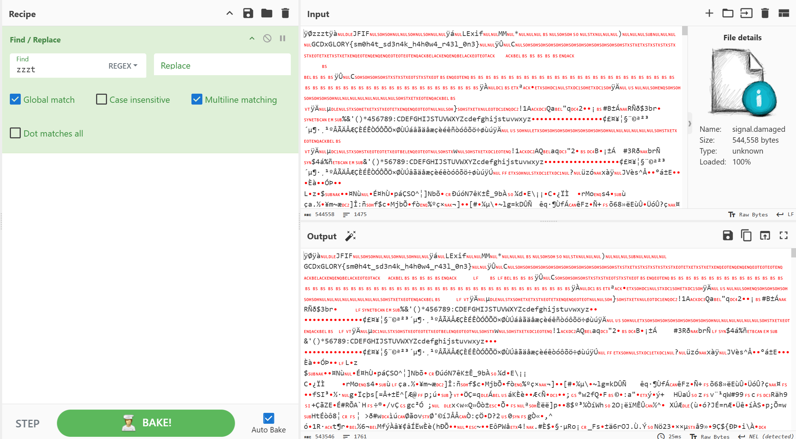
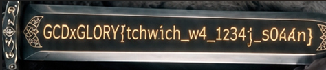

# Tchwich

| | |
|---|---|
| **Category** | Steganography |
| **Difficulty** | Easy |
| **Type** | Dynamic |
| **Points** | 500 |
| **Author** | K4ir0s |
| **Flag** | `GCDxGLORY{tchwich_w4_1z34j_s0k4n}` |

## Description



> K4ir0s l9a wahd lfile jay men wa7ed système de surveillance. kantl9adya
> normal, walakin mn b3d wa7ed l'incident, wella dakchi impossible it7ell.
> Kir0s chakk belli chi interference dkhlat f les données dyal fichier, w
> l'info originale mazal t9der trje3.

*(Translation: K4ir0s found a file that came from a surveillance system. It looked normal, but after an incident it became impossible to open. K4ir0s suspects some interference got into the file's data, and that the original information can still be recovered.)*

**Flag format:** `GCDxGLORY{...}`

## Files

- [`files/signal.damaged`](files/signal.damaged) (544 558 bytes)

## TL;DR

`signal.damaged` is a **JPEG** that was corrupted by inserting the 4 ASCII bytes `zzzt` **253 times** at different places. Remove every `zzzt` and the image opens. The real flag is **engraved on the sword** in the picture. A decoy flag is hidden in the metadata.

## Solution

### Step 1: Triage

The extension `.damaged` means nothing, so look at the first bytes:

```bash
file signal.damaged
xxd -l 32 signal.damaged
```

```
00000000: ffd8 7a7a 7a74 ffe0 0010 4a46 4946 0001  ..zzzt....JFIF..
```

- `FF D8` is the start of a **JPEG**.
- Right after it we expect `FF E0 .. JFIF`, but there are 4 extra bytes: `7a 7a 7a 74` = `zzzt`.

Those 4 bytes should not be there, and that is why no viewer can open the image.

### Step 2: Confirm the pattern

Scroll through the file in a hex editor (HxD, HexEd.it) or count the pattern:

```bash
grep -c zzzt signal.damaged          # lines containing it
python3 -c "print(open('signal.damaged','rb').read().count(b'zzzt'))"   # 253
```

`zzzt` appears **253 times**, spread across the whole file. This is not valid JPEG data, it is **injected noise** ("interference" in the description). Since the noise is always the same 4 bytes, we can remove it and get the original bytes back. This is not encryption, it is a byte-insertion repair.

### Step 3: Remove the noise

**With CyberChef (the intended way)**

1. Open [CyberChef](https://gchq.github.io/CyberChef/) and load `signal.damaged` as input (**Open file as input**).
2. Add the operation **Find / Replace**.
3. In *Find*, type `zzzt` (mode **REGEX**). Leave *Replace* **empty**. Tick **Global match**.
4. Click **BAKE**. The output is 543 546 bytes (544 558 - 253 x 4).
5. Click **Save output to file** and name it `recovered.jpg`.



> The output must stay **raw bytes**. Don't copy and paste it into a text editor, or the binary data will be damaged.

**With Python** ([`solve/solve.py`](solve/solve.py))

```python
from pathlib import Path
raw = Path("signal.damaged").read_bytes()
Path("recovered.jpg").write_bytes(raw.replace(b"zzzt", b""))
```

```
$ python3 solve.py signal.damaged
Injected 'zzzt' patterns: 253
JPEG header OK: True | end marker OK: True
Decoy flag in EXIF comment: GCDxGLORY{sm0h4t_sd3n4k_h4h0w4_r43l_0n3}
```

### Step 4: The decoy flag

In the CyberChef input (and in `exiftool recovered.jpg`, or `strings`) there is a readable flag right after the JPEG header:

```
GCDxGLORY{sm0h4t_sd3n4k_h4h0w4_r43l_0n3}
```

**This is a decoy.** The text is a joke written in Darija leetspeak, ending with "real one", and it is meant to catch players who stop at the first flag they see. The real flag is in the image.

### Step 5: Read the flag on the sword

Open `recovered.jpg`. It is a portrait of a Viking holding a sword, and the flag is **engraved vertically on the blade**:


Rotate the picture to read it more easily:



## Flag

```
GCDxGLORY{tchwich_w4_1z34j_s0k4n}
```

## Main Ideas For This Chall

- A file's header (`FF D8` for JPEG) tells you what it **should** be. Compare it with what it **is**.
- Repeated ASCII strings inside a binary file are suspicious.
- Corruption made of **inserted bytes** can often be repaired by removing them.
- Keep binary data **binary**: never save an image through a text editor.
- The first flag you find may be a **decoy**. Always check the final result.

## Tools used

- `file`, `xxd` (or a hex editor)
- [CyberChef](https://gchq.github.io/CyberChef/) (Find / Replace)
- Python 3 (alternative)
