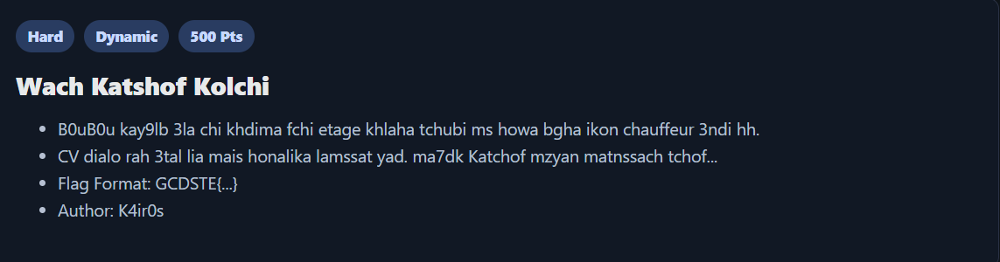
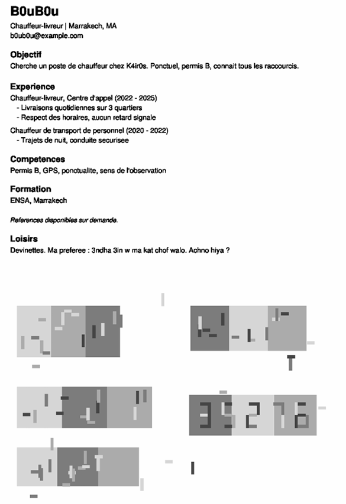
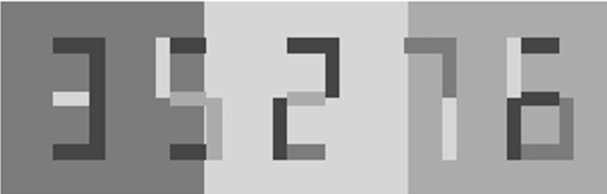

# Wach Katshof Kolchi

| | |
|---|---|
| **Category** | Steganography |
| **Difficulty** | Hard |
| **Type** | Dynamic |
| **Points** | 500 |
| **Author** | K4ir0s |
| **Flag** | `GCDSTE{3t1_Boss4_l3m0_k4ir0s}` |

## Description



> B0uB0u kay9lb 3la chi khdima fchi etage khlaha tchubi ms howa bgha ikon chauffeur 3ndi hh.
> CV dialo rah 3tal lia mais honalika lamssat yad. ma7dk Katchof mzyan matnssach tchof...

*(Rough meaning: B0uB0u is looking for a job and wants to be a driver for me. His CV caused me trouble, but there is a hidden touch in it. "Look well, and don't forget to look..." Correct this if you meant something else.)*

**Flag format:** `GCDSTE{...}`

## Files

- [`files/cv_b0ub0u.pdf`](files/cv_b0ub0u.pdf): a one-page CV of a driver called B0uB0u

## TL;DR

The CV hides the flag behind **4 levels**, and there are **two decoys** on the way:

| Level | What you do | Result |
|---|---|---|
| 1. Key | Solve a Darija riddle + read 5 almost-white digits on the page | `l1br4_35276` |
| 2. Carrier | Read the comments in the page's content stream, decode them with an alphabet built from the key | 32 bytes: `ct (4)` + `salt (16)` + `nonce (12)` |
| 3. Honey | Turn the 4 bytes `ct` into 4 words using the key | password `zerak-kilim-hanou-bamat` |
| 4. Gate | Derive an AES key with scrypt and try it on the PDF's unreferenced objects | object 10 gives the flag |

**Decoys:** (1) a fake key hidden in the `/Keywords` metadata, (2) random objects that never open.

---

## Solution

### Step 1: First look, almost nothing

```bash
strings -n 6 cv_b0ub0u.pdf | head
pdfinfo cv_b0ub0u.pdf
pdftotext cv_b0ub0u.pdf -
pdfdetach -list cv_b0ub0u.pdf      # 0 embedded files
pdfimages -list cv_b0ub0u.pdf      # no images
```

The CV text is ordinary (driver, 3 years of experience, ENSA Marrakech...). No flag, no attachment, no image. Two things look strange:
- The `/Keywords` field ends with a series of **invisible characters**.
- The file has **4 objects of 45 bytes (9 to 12)** that nothing in the PDF points to.

The page content is compressed (Flate), so `strings` can't see inside it.

### Step 2: The decoy in the metadata

The invisible characters are two zero-width Unicode characters: `U+200B` = 0 and `U+200C` = 1. Read in groups of 8 bits, they give text:

```python
from pypdf import PdfReader
kw = PdfReader("cv_b0ub0u.pdf").metadata["/Keywords"]
bits = "".join("1" if c == "\u200c" else "0" for c in kw if c in "\u200b\u200c")
print(bytes(int(bits[i:i+8], 2) for i in range(0, len(bits), 8)))
# b'k41r0s_2025'
```

`k41r0s_2025` looks like a real key (it contains "K4ir0s" from the CV), but it is a **trap**. It opens a complete chain that gives a **fake flag** of the same format. If you stop here you submit the wrong flag.

### Step 3: Comments hidden in the page stream

Decompress the PDF to read the page content:

```bash
qpdf --qdf --object-streams=disable cv_b0ub0u.pdf out.qdf
```

Between the text operators there are **PDF comments** (lines starting with `%`):

```
(B0uB0u) Tj
% gs fcimzg
% cid swia4pl
/F1 11 Tf
...
```

Group them by their tag (the word after `%`). There are 6 tags:

| Tag | Fragments | Symbols | Role |
|---|---|---|---|
| `cid` | 8 | 52 | **real carrier** |
| `ctm` | 8 | 52 | decoy carrier |
| `gs`, `bbox`, `mc`, `clip` | 3 to 5 | 20 to 35 | noise, no data |

Only two tags have 8 fragments and 52 symbols. 52 symbols of 5 bits = 260 bits = **32 bytes** (4 bits of padding), which is exactly `4 + 16 + 12`. Hex, base32, base64 and base85 give only noise, so the alphabet is **custom**, and we need the key to build it.

The 8 `cid` fragments, in stream order:

```
swia4pl hh7kue b5hjddj ztnf3j ohe3mrp b3bos6u wq2rga vhbmgi
```

### Step 4: The riddle

The *Loisirs* (hobbies) section says:

> Devinettes. Ma preferee : **3ndha 3in w ma kat chof walo**. Achno hiya ?

In written Darija, the digit **3** stands for the letter *ain*. The sentence means *"it has an eye and sees nothing"*. The answer is a **needle**: **lebra**.

The author writes in leet (`B0uB0u`, `K4ir0s`). Since `3` is already used for *ain*, the letter `e` becomes `1`. The rule is:

```
a -> 4    e -> 1    o -> 0    i stays i
lebra -> l1br4
```

> **Trap:** the decoy key `k41r0s_2025` turns `i` into `1` (`k41r0s`), but the real rule leaves `i` unchanged (as in `K4ir0s`).

### Step 5: The faint digits

The CV says "sens de l'observation". The page contains vector shapes that are **almost white** (gray levels 251 to 254 on a 255 background). They are not text, so no text extractor sees them. Render the page and **stretch the contrast**:

```bash
pdftoppm -png -r 110 cv_b0ub0u.pdf page
```

```python
from PIL import Image
im = Image.open("page-1.png").convert("L")
im.point(lambda v: 0 if v < 250 else int((v - 250) * 51)).save("digits_enhanced.png")
```

All levels from 250 to 255 are spread over 0 to 255:



Five panels with bars appear. **Four are decoys** (random bars). The real one is at the bottom right, where the bars form **7-segment digits**:



The digits are **3 5 2 7 6**.

> **Why a single threshold fails:** every segment is drawn at a different gray level from the band behind it. Isolating one level only shows pieces. You need to compare each pixel with its neighbours, or stretch the contrast like above.

### Step 6: Build the key and the alphabet

```
key = leet("lebra") + "_" + digits = l1br4_35276
```

The carrier alphabet is a **keyword base32**: first the characters of the key that exist in `abcdefghijklmnopqrstuvwxyz234567` (in order, no duplicates). Here that gives `l b r 4 3 5 2 7 6`; the `1` and `_` are not in base32, so they are skipped. Then the remaining characters follow in normal order.

```python
STD = "abcdefghijklmnopqrstuvwxyz234567"
seen = []
for c in KEY.decode():
    if c in STD and c not in seen: seen.append(c)
ALPHA = "".join(seen) + "".join(c for c in STD if c not in seen)
# lbr435276acdefghijkmnopqstuvwxyz
```

Each symbol is its index in `ALPHA`, written on 5 bits. Join the bits and cut them in bytes:

```python
bits = "".join(format(ALPHA.index(c), "05b") for c in "".join(by["cid"]))
car = bytes(int(bits[i:i+8], 2) for i in range(0, len(bits) - 7, 8))
# c72091d80f79e5a604af8ad71fe68d246af61262b0481ae11ae5cc27276f0cdd
```

| Field | Size | Value |
|---|---|---|
| `ct` (honey) | 4 bytes | `c72091d8` |
| `salt` | 16 bytes | `0f79e5a604af8ad71fe68d246af61262` |
| `nonce` | 12 bytes | `b0481ae11ae5cc27276f0cdd` |

> With a wrong key you also get 32 bytes that look valid. There is **no feedback** at this step.

### Step 7: Honey cipher, from 4 bytes to 4 words

Following the spec given to players: there is a **lexicon of 256 words**, `LEX[16*i + j] = A[i] + B[j]` (16 syllables `A`, 16 syllables `B`). The keystream is `sha256(KEY | "|honey|" | n)` with `n` on 4 bytes big-endian. Each word is `LEX[(ct[k] - ks[k]) mod 256]`.

For the right key the keystream starts with `b7ef08d3`:

| ct[k] | ks[k] | (ct - ks) mod 256 | i, j | Word |
|---|---|---|---|---|
| `0xc7` = 199 | `0xb7` = 183 | 16 | 1, 0 | ze + rak = **zerak** |
| `0x20` = 32 | `0xef` = 239 | 49 | 3, 1 | ki + lim = **kilim** |
| `0x91` = 145 | `0x08` = 8 | 137 | 8, 9 | ha + nou = **hanou** |
| `0xd8` = 216 | `0xd3` = 211 | 5 | 0, 5 | ba + mat = **bamat** |

The password is `zerak-kilim-hanou-bamat`.

> With any other key you also get 4 well-formed words (for example `gukar tawan zehib cherak` for the token `35277`). The only way to know if it is right is the next step.

### Step 8: The gate, scrypt then AES-256-GCM

```python
pw = hashlib.scrypt(b"zerak-kilim-hanou-bamat", salt=salt,
                    n=2**16, r=8, p=1, maxmem=2**28, dklen=32)
for obj in (9, 10, 11, 12):
    AESGCM(pw).decrypt(nonce, blob, None)
```

Each of the four unreferenced objects is 45 bytes: 29 bytes of text + a 16-byte GCM tag. The tag works as an **oracle**: only the right password makes it valid.

| Object | Content | Result |
|---|---|---|
| 9 | random bytes | invalid tag |
| **10** | the real blob | **valid tag: the flag** |
| 11 | random bytes | invalid tag |
| 12 | decoy blob | invalid tag with this password |

Each try costs about 0.2 s because of scrypt, so brute-forcing is slow.

### The decoy path

With the fake key `k41r0s_2025` and the `ctm` tag, the same steps give the honey words `hanou chetir bakar zeley`, and object **12** opens with:

```
GCDSTE{n1c3_try_but_n0t_th1s}
```

It has the same length and format as the real flag, so only a careful player will recognize it as a decoy.

### Run it all at once

[`solve/solve.py`](solve/solve.py) does everything (the 5 digits are read visually and given as an argument):

```
$ python3 solve.py cv_b0ub0u.pdf 35276
bait key (decoy): k41r0s_2025
DECOY : GCDSTE{n1c3_try_but_n0t_th1s} | words=['hanou', 'chetir', 'bakar', 'zeley'] object=12
real key: l1br4_35276
REAL  : GCDSTE{3t1_Boss4_l3m0_k4ir0s} | words=['zerak', 'kilim', 'hanou', 'bamat'] object=10
```

## Flag

```
GCDSTE{3t1_Boss4_l3m0_k4ir0s}
```

## Main Ideas For This Chall

- Check **all** the metadata, but don't trust the first key you find: it can be a decoy.
- Invisible **zero-width characters** can hide text.
- A PDF content stream can hold **comments** that text extractors and `strings` never show.
- Shapes with colors **very close to the background** can hide digits: stretch the contrast of the rendered page.
- A **keyword alphabet** ties the decoding to the key.
- A **honey cipher** gives plausible output for every wrong key, so the AES-GCM tag is the only signal.
- Unreferenced PDF objects can hold encrypted data.

## Tools used

- `strings`, `pdfinfo`, `pdftotext`, `pdfdetach`, `pdfimages`, `pdftoppm` (poppler)
- `qpdf`
- Python 3 with `pypdf`, `Pillow`, `cryptography`
