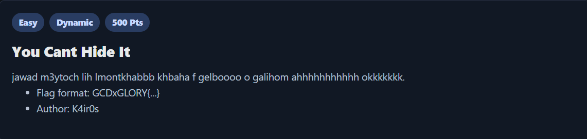
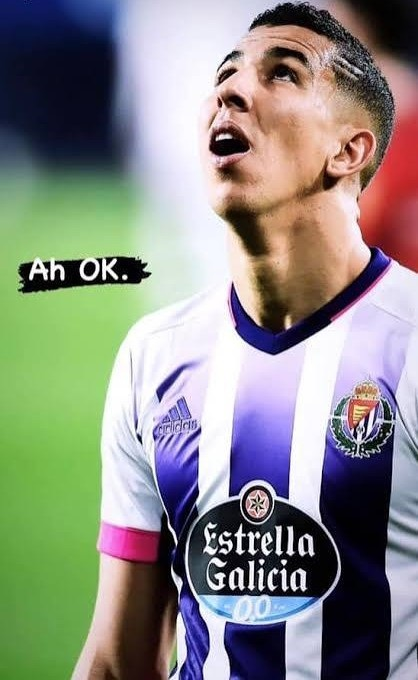

# You Cant Hide It

| | |
|---|---|
| **Category** | Steganography / Forensics |
| **Difficulty** | Easy |
| **Type** | Dynamic |
| **Points** | 500 |
| **Author** | K4ir0s |
| **Flag** | `GCDxGLORY{m4_k0lch1_k4yb4n_w4l4kin_l91t1h}` |

## Description



> jawad m3ytoch lih lmontkhabbb khbaha f gelboooo o galihom ahhhhhhhhhhh okkkkkkk.

**Flag format:** `GCDxGLORY{...}`

## Files

- [`files/ah_ok.jpg`](files/ah_ok.jpg): a normal-looking photo (418 x 680 px) with an "Ah OK." caption



## TL;DR

The photo hides **three layers**:
1. A **Base64 clue** in the EXIF metadata.
2. An **encrypted file glued after the end of the JPEG**, starting with the text `Salted__`.
3. The clue tells us the **password**: `width x height` of the image + `_9lb`.

Decrypt the hidden data with OpenSSL, open the ZIP inside, read the flag.

```
EXIF clue --> password 418x680_9lb --> carve "Salted__..." --> decrypt --> ZIP --> flag
```

---

## Solution

### Step 1: Check the file and its metadata

The picture alone is not the flag. When a stego challenge gives you a normal photo, always look at the **metadata** first.

```bash
file ah_ok.jpg
exiftool ah_ok.jpg
```

`exiftool` shows an **Image Description** that is not a normal caption but a long Base64 string:

```
TDlsYiBrYXk3c2ViIGwzcmQgeCB0b2wsIHcgemlkIF85bGIuIE1sbGkgdHNhbGkgdHN3aXJhLCBxZWxsZWIgM2xhIFNhbHRlZF9fLiAod2lkdGggeCBoZWlnaHQpXzlsYg==
```

> The `==` at the end and the letters/digits only are typical signs of **Base64**.

### Step 2: Decode the clue

```bash
exiftool -s3 -ImageDescription ah_ok.jpg | base64 -d
```

(or paste it in [CyberChef](https://gchq.github.io/CyberChef/) with **From Base64**)

Result:

```
L9lb kay7seb l3rd x tol, w zid _9lb. Mlli tsali tswira, qelleb 3la Salted__. (width x height)_9lb
```

In simple words (rough translation): *"The heart computes width x height, and adds `_9lb`. When the picture ends, look for `Salted__`."*

So the clue gives us two things:
- **The password format:** `(width x height)_9lb`
- **What to search for:** the text `Salted__`

### Step 3: Build the password

We need the image size:

```bash
identify ah_ok.jpg
# ah_ok.jpg JPEG 418x680 ...
```

or with Python: `python3 -c "from PIL import Image; print(Image.open('ah_ok.jpg').size)"`

The size is **418 x 680**, so the password is:

```
418x680_9lb
```

### Step 4: Find the hidden data after the image

A JPEG ends with the marker `FF D9`. Image viewers stop there, so anything written **after it** is invisible but still in the file.

Search for `Salted__` (the first 8 bytes of a file encrypted with the `openssl enc` command):

```bash
grep -obUaP "Salted__" ah_ok.jpg
# 80546:Salted__
```

In a hex editor you can see it right after `FF D9`:

```
... ff d9 53 61 6c 74 65 64 5f 5f ...
          S  a  l  t  e  d  _  _
```

Carve everything from `Salted__` to the end of the file (224 bytes):

```bash
python3 - <<'PY'
from pathlib import Path
b = Path('ah_ok.jpg').read_bytes()
p = b.index(b'Salted__')
assert b[p-2:p] == bytes.fromhex('ffd9')     # right after the JPEG end marker
Path('payload.enc').write_bytes(b[p:])
print('offset:', p)
PY
```

Or with `dd`: `dd if=ah_ok.jpg of=payload.enc bs=1 skip=80546`

### Step 5: Decrypt

The data is an **OpenSSL encrypted file** (`Salted__` is its header). The standard settings are AES-256-CBC with PBKDF2 and 100000 iterations:

```bash
openssl enc -d -aes-256-cbc -pbkdf2 -iter 100000 \
  -in payload.enc -out payload.zip -pass pass:418x680_9lb
```

```bash
file payload.zip
# payload.zip: Zip archive data
```

> A wrong password gives `bad decrypt`, so you know right away if the password is wrong.
> `-pbkdf2` needs **OpenSSL 1.1.1 or newer**. On Windows you can use the OpenSSL from Git Bash.

### Step 6: Read the flag

```bash
unzip -l payload.zip              # one file: courier_note.txt
unzip -p payload.zip courier_note.txt
```

```
You found the message.

GCDxGLORY{m4_k0lch1_k4yb4n_w4l4kin_l91t1h}
```

### All steps in one script

[`solve/solve.py`](solve/solve.py) does everything (clue, password, carving, decryption, ZIP):

```
$ python3 solve.py ah_ok.jpg
Clue: L9lb kay7seb l3rd x tol, w zid _9lb. Mlli tsali tswira, qelleb 3la Salted__. (width x height)_9lb
Password: 418x680_9lb
Encrypted payload at offset 80546 (224 bytes)
You found the message.

GCDxGLORY{m4_k0lch1_k4yb4n_w4l4kin_l91t1h}
```

## Flag

```
GCDxGLORY{m4_k0lch1_k4yb4n_w4l4kin_l91t1h}
```

## Main Ideas For This Chall

- A photo can hold secrets in its **metadata** (EXIF), so always run `exiftool`.
- Data placed **after the end marker** (`FF D9` for JPEG) is ignored by viewers but stays in the file (**file carving**).
- Magic text like `Salted__` is the signature of an **OpenSSL-encrypted** file.
- Clues can be **encoded** (Base64) and may tell you how to build the key.
- Never re-save or compress the image: that would delete the metadata and the appended data.

## Tools used

- `exiftool`, `file`, `identify` (ImageMagick) or Python Pillow
- CyberChef or `base64`
- A hex editor, `grep` or Python (to carve the data)
- OpenSSL (to decrypt), `unzip`
